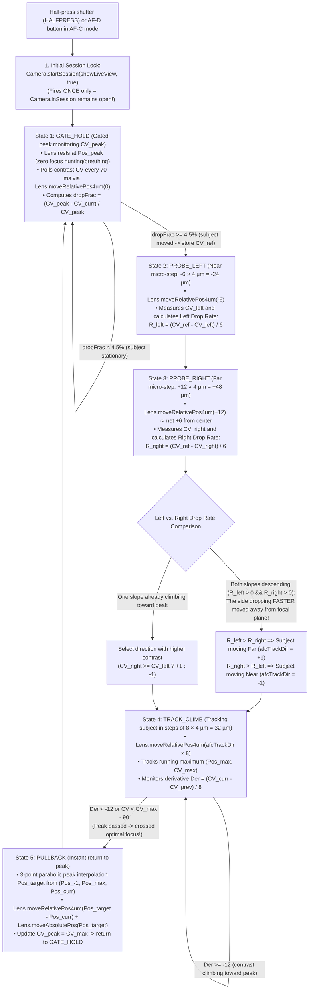

# 05 – Module `MOD-FEAT-AFC`: Continuous Autofocus (`AF-C` – Gated CDAF & Peak Drop Rate)

This document details the complete research, reverse-engineering of the Linux `/usr/bin/camera-daemon` and low-level Zynq-7000 coprocessor `FARM` (`../src/services/af_service.c` and `../src/fpga/autofocus.c`), and implementation of a full-fledged **Continuous Autofocus (`AF-C`) module powered by Gated CDAF and Left vs. Right Peak Drop Rate comparison** for the Hasselblad X1D-50c (`Wedge`), built directly on top of **stock factory firmware `v1.25.0`**:
- **[`firmware/X1D_v1_25_0_afc.cim`](file:///d:/Plocha/projekty/X1D_FirmwareDump/firmware/X1D_v1_25_0_afc.cim)** – Production release featuring closed-loop **Gated CDAF + Peak Drop Rate Tracking** via direct $4\ \mu\text{m}$ lens micro-stepping (`Lens.moveRelativePos4um`) and parabolic peak interpolation without session cycling.
- **[`firmware/X1D_v1_25_0_afc_old.cim`](file:///d:/Plocha/projekty/X1D_FirmwareDump/firmware/X1D_v1_25_0_afc_old.cim)** – First-generation prototype based on periodic cycling of `Camera.stopSession()` $\rightarrow$ `Camera.startSession(showLiveView, true)`.

---

## 1. Community Research & Prior Art (X2D 100C / 907X vs. 50c Platforms)

Prior to designing a custom implementation, we mapped all public and recent community research into Hasselblad firmware modifications:

| Project / Repository | Target Models | Scope & `AF-C` Availability |
| :--- | :--- | :--- |
| **`Gothenburg-R-D-Team/x2d-907-one-click-extension-toolkit`** (*HRAP* by `u/rrRadium`, Oct–Nov 2026) | **X2D 100C**, **907X & CFV 100C** (`FW 4.2.0`) | Unlocked `AF-C` (Continuous AF), `AF-T` (Face/Eye Tracking), configurable AF speed buffer, and 4/6/16-shot Pixel Shift on the original X2D 100C. On the 100MP platform (`Android / Rockchip`), `AF-C` routines were already compiled into the binary from the **X2D II 100C** (phase detection PDAF) and merely required configuration toggles. The repository was removed in November 2026 following legal notice (*"HasselGate"*). |
| **`duart38/Hazel-firmware`** | **X1D-50c** (`FW 1.25.0`) | Injects color profiles and film simulations (`.look` tables) into LiveView via a custom companion binary `Catkin`. **Contains no autofocus (`AF-C`) modifications.** |
| **`derrickyau9/Hasselblad_X1D_II_FirmwareDump`** & **`YuHaoyua/hasselblad-x1d-reverse-engineering`** | **X1D II 50C** / **X1D-50c** | Tools for `.cim` container decryption (`VHABCIM`) and `rootfs` extraction. **No `AF-C` implementation existed for 50c or 50c II cameras.** |

> [!IMPORTANT]
> **Key Finding:** On 50MP models (**X1D-50c** and **X1D II 50C**), which rely entirely on contrast detection autofocus (**CDAF** computed in the `FARM` FPGA), nobody had previously implemented `AF-C`. While the X2D 100C could leverage latent PDAF routines from the X2D II, for the **X1D-50c (`Wedge`)** we had to disassemble the entire stack—from Linux `/usr/bin/camera-daemon` and `libappscommon.so.1.0.0` down to the Dual-QSPI Zynq-7000 `FARM` firmware—and architect an authentic **Gated CDAF engine with Peak Drop Rate evaluation**.

---

## 2. Deep Dive into `.cim`: Dissecting `FARM` Zynq-7000 (`af_service.c`) & `/usr/bin/camera-daemon`

### 2.1 De-Interleaving Dual-QSPI `FARM` Firmware (`bootimage_even-wedge.bin` + `bootimage_odd-wedge.bin`)
Inside `rootfs` (`/lib/firmware/hbl/farm/`), two binary files of size `3,954,444 B` (`3.95 MB`) are stored:
- `bootimage_even-wedge-v1.25.0-13075-c9bb91d.bin` (flashed to `/dev/mtd3`)
- `bootimage_odd-wedge-v1.25.0-13075-c9bb91d.bin` (flashed to `/dev/mtd4`)

Analysis revealed that the **FARM** chip is a **Xilinx Zynq-7000 SoC** (dual Cortex-A9 + Artix/Kintex-7 programmable logic) wired to dual parallel QSPI NOR flash memories in **Dual-Parallel QSPI x8 (bit-interleaved)** mode:
- Every byte of the Zynq `BOOT.BIN` image is split into **even bits (`0, 2, 4, 6`)** stored in `bootimage_even-wedge.bin` and **odd bits (`1, 3, 5, 7`)** in `bootimage_odd-wedge.bin`.
- Re-interleaving the bits yields a `7,908,888 B` (`7.91 MB`) unified image `farm_wedge_boot.bin` with standard Xilinx Zynq Boot Image headers (`0xAA995566`, `"XNLX"`), containing 3 partitions:
  1. **Partition 0 (`offset 0x001700`, `114,708 B`):** Xilinx Zynq First Stage Boot Loader (`FSBL`).
  2. **Partition 1 (`offset 0x01D740`, `5,979,936 B`):** PL FPGA Bitstream – implements the hardware **Brenner contrast filter** (`../src/fpga/autofocus.c`, configurations `Brenner configuration: X | Y`, `X | Y / 4`, `X | Y / 2`, and window crop `af_crop_setup`).
  3. **Partition 2 (`offset 0x5D1680`, `1,808,280 B`, load address `0x00100000`):** ARM Cortex-A9 FreeRTOS application binary (`farm_app.bin`), compiled from `/home/jenkins/workspace/Build-Farm-Wedge/farm-wedge/app/src/`.

### 2.2 The `../src/services/af_service.c` State Machine (`vaddr 0x198700 .. 0x1A5490`)
Disassembling `farm_app.bin` revealed the complete CDAF pipeline in **`../src/services/af_service.c`** (strings at `0x2466E4 .. 0x247AA4`, state struct in RAM at `0x006BB59C`, circular contrast buffer at `0x006BB5CC`):

1. **Lens Calibration Profiles (`af_service_update_lenstype` @ `0x1987C4 .. 0x199950`):**
   - Contains hardcoded profiles for `XCD30`, `XCD45`, `XCD90`, `XCD120`, and `HCC24..HCC300` (newer lenses read parameters directly from lens EEPROM via `suc_get_cd_focus_params_req`).
   - For each lens, loads: `FL min`, `FL max`, `Speed`, `SpeedwConv`, `finalpos_margin`, `adaptive_offset`, `dir offset`, `add offset`, `max_pos_error`, and `filter type`.
2. **Execution of `image_find_focus_req` (`AF_SERVICE_SM` @ `0x19B870 .. 0x19D174`):**
   Whenever Linux (`/usr/bin/camera-daemon`) calls `StartSession(showLiveView, true)` $\rightarrow$ `ImageProxy::findFocus`, `AF_SERVICE_SM` on `FARM` executes a **blind two-edge sweep (*Full-Sweep CDAF*)**:
   - `afstate_wait_for_af_video_mode` (`0x19BC54`) – switches Sony IMX161 sensor to cropped AF readout (`AUTOFOCUS_setup` / `AUTOFOCUS_start`).
   - `afstate_enable_cdaf_in_lens` (`0x19BDBC`) – sends `lens_af_cmd_cdaf_enable_req` to the lens.
   - `afstate_scan_for_first_edge` (`0x19BEC0`) – drives the lens in one direction, computing position, Brenner contrast, and first derivative on every frame:
     `Pos = %d CV = %lu CS = %lu Speed = %ld Der = %.3f idx = %d` (`0x1A2CB0`).
     Continues sweeping until contrast exceeds a statistical Z-score threshold (`Z-score: %.2f` at line `1311`, `0x19D2E8`) and locks the leading edge (`Found first edge (Front/Back focus edge)` at line `1334`/`1343`, `0x19D48C`).
   - `afstate_scan_for_second_edge` (`0x19C054`) – **deliberately sweeps past the peak of sharpness** onto the descending slope (`Found second edge (Back focus edge)` at line `1400`/`1406`, `0x19D788`) to sample points on both sides of the curve.
   - `afstate_move_back_over_peak` (`0x19C530`) & `afstate_move_to_final_position` (`0x19C96C`) – validates sample points on both left and right sides of the maximum (`Only %d values on left side of max` @ `0x19E93C`, `Only %d values on right side of max` @ `0x19E9FC`), fits a 3-point parabola (`Parabolic curve fit` @ `0x1A01FC`), adds `finalpos_margin + adaptive_offset + dir offset`, and **reverses the lens back to the computed peak**.
   - `afstate_disable_cdaf_in_lens` (`0x19B89C`) – disables lens CDAF and reports `FOCUS FOUND`.

> [!WARNING]
> **Why Session Cycling (`stopSession` $\rightarrow$ `startSession`) Fails on Real Hardware:**
> Because every `image_find_focus_req` forces a complete sweep across **both edges** (`scan_for_first_edge` $\rightarrow$ `scan_for_second_edge` $\rightarrow$ `move_back_over_peak`), calling `startSession` in a loop causes relentless hunting back and forth across the entire focal throw (*full-sweep hunting*), alongside repeated sensor video-mode resets. True `AF-C` must keep the session **permanently active (`Camera.inSession`)** and drive the lens using **Gated CDAF with Peak Drop Rate evaluation**!

---

## 3. Low-Level IPC & Lens D-Bus Interface (`LensProxy` in `libappscommon.so.1.0.0`)

Inspecting `.dynsym` tables in `libappscommon.so.1.0.0` (`0x09D5E4`), `libAppsMessaging.so`, and `/usr/bin/msg2dbus` (`0x0534E4`) revealed that the QML singleton **`Lens`** (`import com.hasselblad.lens 1.0`) provides low-level micro-stepping controls without invoking the full `image_find_focus_req` routine:

| QML Method / Signal on `Lens` (`LensProxy`) | C++ Symbol in `libappscommon.so.1.0.0` | D-Bus Method (`com.hasselblad.lens`) / IPC to `SUC` | Description |
| :--- | :--- | :--- | :--- |
| **`Lens.focusUpdateState(bool)`** | `_ZN9LensProxy16focusUpdateStateEb` (`0x4AD94D10`) | `video_focus_pos_state` $\rightarrow$ `lens_video_focus_pos_state_req` | Enables continuous position reporting of the focus group (`video_focus_pos`) during LiveView. |
| **`Lens.moveRelativePos4um(short)`** | `_ZN9LensProxy18moveRelativePos4umEs` (`0x4AD94F0C`) | `af_cmd_relative_position_4um` $\rightarrow$ `lens_af_cmd_relative_position_4um_req` | Advances the XCD focus element by a relative step in multiples of **$4\ \mu\text{m}$** (positive = Far/Inf, negative = Near, `0` = poll without motion). |
| **`Lens.onMoveRelativePos4umResult(int result)`** | `_ZN9LensProxy34onMoveRelativePos4umResultFinished...` (`0x4AD943D4`) | Asynchronous D-Bus return converted via `QVariant::toInt()` | Signal emitted when a $4\ \mu\text{m}$ micro-step finishes, passing a 32-bit integer `result` directly into QML. |
| **`Lens.moveAbsolutePos(short)`** | `_ZN9LensProxy15moveAbsolutePosEs` (`0x4AD95108`) | `af_cmd_position` $\rightarrow$ `lens_af_cmd_position_req` | Relocates the lens to an absolute target index (e.g. returning to the calculated peak). |
| **`Lens.moveAtSpeed(short)`** | `_ZN9LensProxy11moveAtSpeedEs` (`0x4AD95304`) | `af_cmd_speed` $\rightarrow$ `lens_af_cmd_speed_req` | Smooth continuous motor movement at a specified velocity. |

---

## 4. Mathematical Model & Architecture of our Gated CDAF + Peak Drop Rate Engine (`X1D_v1_25_0_afc.cim`)

In [`firmware/X1D_v1_25_0_afc.cim`](file:///d:/Plocha/projekty/X1D_FirmwareDump/firmware/X1D_v1_25_0_afc.cim), we replaced session cycling inside [`victory_gui_qml/main.qml`](file:///d:/Plocha/projekty/X1D_FirmwareDump/victory_gui_qml/main.qml) with a **5-state closed-loop Gated CDAF controller with Left vs. Right Drop Rate comparison and parabolic peak interpolation**:



### Mathematical Rules:
1. **Peak Gating (*Gated CDAF* – Zero Focus Hunting):**
   As long as relative contrast reduction from the memorized peak satisfies:
   $$\frac{CV_{\text{peak}} - CV_{\text{curr}}}{CV_{\text{peak}}} < 0.045 \quad (4.5\%)$$
   the focus motor remains completely at rest in state `GATE_HOLD (1)`.
2. **Direction Disambiguation via Drop Rate Comparison:**
   Once contrast drops by $\ge 4.5\%$, the controller executes two symmetrical micro-steps $\pm\Delta p = \pm 6 \times 4\ \mu\text{m}$ ($\pm 24\ \mu\text{m}$) around the reference position and measures the drop rate on each side:
   $$R_{\text{left}} = \frac{CV_{\text{ref}} - CV_{\text{left}}}{\Delta p}, \qquad R_{\text{right}} = \frac{CV_{\text{ref}} - CV_{\text{right}}}{\Delta p}$$
   - When the subject is actively moving, both slopes may descend simultaneously ($R_{\text{left}} > 0 \land R_{\text{right}} > 0$).
   - **Physics of Relative Motion:** Moving the lens *away* from subject displacement causes relative speed to compound, making contrast drop **steeper**. Moving *with* subject displacement causes contrast to drop **slower**.
   - **Decision Rule:** The slope with higher drop rate is farther from true focus:
     $$\text{afcTrackDir} = \begin{cases} +1 \ (\text{Far / Inf}), & \text{if } R_{\text{left}} > R_{\text{right}} \\ -1 \ (\text{Near}), & \text{if } R_{\text{right}} \ge R_{\text{left}} \end{cases}$$
3. **Peak Overshoot Detection ($\text{Der} < 0$) & Parabolic Pull-Back:**
   In state `TRACK_CLIMB (4)`, the lens advances along `afcTrackDir` in micro-steps $h = 8 \times 4\ \mu\text{m} = 32\ \mu\text{m}$, evaluating the derivative:
   $$\text{Der} = \frac{CV_{\text{curr}} - CV_{\text{prev}}}{h}$$
   When contrast drops past the summit ($\text{Der} < -12$ or $CV_{\text{curr}} < CV_{\text{max}} - 90$), the controller fits a 3-point parabola across $(Pos_{-1}, CV_{-1}), (Pos_{\text{max}}, CV_{\text{max}}), (Pos_{\text{curr}}, CV_{\text{curr}})$ (matching `af_service.c` at `0x1A01FC`):
   $$Pos_{\text{target}} = Pos_{\text{max}} + \operatorname{round}\!\left(\frac{h \cdot (CV_{-1} - CV_{\text{curr}})}{2 \cdot (CV_{-1} - 2\,CV_{\text{max}} + CV_{\text{curr}})}\right)$$
   and in state `PULLBACK (5)` returns the lens precisely to $Pos_{\text{target}}$.

---

## 5. Optical Physics CDAF Simulator in ARMv7 Emulator ([`mock_hardware_dbus.py`](file:///d:/Plocha/projekty/X1D_FirmwareDump/arm_emulator/mock_hardware_dbus.py))

To mathematically validate closed-loop Gated CDAF in the ARMv7 emulator (`run_arm_emulator.py --cim .\firmware\X1D_v1_25_0_afc.cim`), we implemented the class **`OpticalCdafSimulator`** in [`arm_emulator/mock_hardware_dbus.py`](file:///d:/Plocha/projekty/X1D_FirmwareDump/arm_emulator/mock_hardware_dbus.py):
- Simulates a moving 3D subject over time $t$: after initial lock, holds position stationary at `1000.0` for `300 ms` (verifying `GATE_HOLD` stability without hunting), then smoothly oscillates subject distance along a sinusoidal path between `Near (935)` and `Far (1085)`:
  $$\text{SubjPos}(t) = 1010.0 + 75.0 \cdot \sin\!\big(1.35 \cdot (t - 0.30)\big)$$
- For any lens position $\text{Pos}$ (in $4\ \mu\text{m}$ steps), computes the FPGA Brenner filter response with depth-of-field half-width $\sigma_{\text{DOF}} = 42$ steps ($168\ \mu\text{m}$):
  $$CV(\text{Pos}, t) = 1800 + \frac{22200}{1 + \left(\frac{\text{Pos} - \text{SubjPos}(t)}{42.0}\right)^2}$$
- On each call to `com.hasselblad.lens.af_cmd_relative_position_4um(step)`, updates virtual lens position, computes instant `CV` and derivative `Der`, emits telemetry matching `af_service.c` (`[FARM-CDAF] Pos = ... SubjPos = ... CV = ... Step = ... Der = ...`), and packs `((cv & 0xFFFF) << 15) | (pos & 0x7FFF)` into a 31-bit integer for `LensProxy::onMoveRelativePos4umResultFinished`.

### Key System Integration Highlights:
1. **GUI Selection for `Continuous Focus (AF-C)`:**
   - In [`PopoverFocusMode.qml`](file:///d:/Plocha/projekty/X1D_FirmwareDump/victory_gui_qml/components/popups/PopoverFocusMode.qml), added **Continuous Focus** with original icon `qrc:///icons/AF_Cont.png` and value `Config.Focus_AFC (2)`.
   - On the control screen ([`ControlScreen.qml`](file:///d:/Plocha/projekty/X1D_FirmwareDump/victory_gui_qml/controlscreen/ControlScreen.qml)) and top-right LiveView badge ([`LiveViewOverlay.qml`](file:///d:/Plocha/projekty/X1D_FirmwareDump/victory_gui_qml/liveview/LiveViewOverlay.qml)), **`AF-C`** is displayed.
2. **AF Mode Memory on Hardware `AF/MF` Button:**
   - Pressing the physical `AF/MF` button toggles between `MF` and the last active AF mode (`AF-S` or `AF-C` stored in `GlobalStateInfo.lastAutoFocusMode`), rather than falling back to `AF-S`.
3. **Hardware Stepping Motor Boost (`DebugAfSpeed = 19000`):**
   - Entering `AF-C` sets `configstore.DebugAfSpeed = 19000` and `DebugAfSpeedEnable = true`. Returning to `AF-S` disables the override for maximum single-shot accuracy.
4. **Clean Audio Feedback in [`AFIndicator.qml`](file:///d:/Plocha/projekty/X1D_FirmwareDump/victory_gui_qml/liveview/AFIndicator.qml):**
   - In `AF-C`, confirmation beep `SndAfFocusFound` sounds **only upon initial lock**. Subsequent re-tracking cycles operate silently, displaying calm green corner brackets (`#39b54a`) without `SndAfFocusFailed` beeps.
5. **Touch-to-Track & Live AF Point Manipulation on EVF Touchpad:**
   - In [`LiveViewImage.qml`](file:///d:/Plocha/projekty/X1D_FirmwareDump/victory_gui_qml/liveview/LiveViewImage.qml) and [`LiveViewOverlay.qml`](file:///d:/Plocha/projekty/X1D_FirmwareDump/victory_gui_qml/liveview/LiveViewOverlay.qml), tapping anywhere in LiveView relocates the focus point (`moveAfPointTo`) and triggers immediate re-tracking.
   - In [`TouchWindow.qml`](file:///d:/Plocha/projekty/X1D_FirmwareDump/victory_gui_qml/common/TouchWindow.qml), the **EVF Touchpad** remains responsive while holding half-press in `AF-C`, allowing smooth focus tracking with the right thumb on the rear LCD while looking through the EVF.
6. **Instant Shutter Priority (`EXPOSURE`):**
   - Full shutter release in any phase of `AF-C` takes immediate precedence: if within the `180 ms` lock window, exposure triggers that millisecond; during any brief transition, flag `afcExposePending` executes immediately in `onInSessionChanged`.

---

## 6. Why This Module is Built on Stock `v1.25.0` (Independent of Lite Edition)

By design, `MOD-FEAT-AFC` operates independently of `MOD-CORE-LITE`:
- Compiling via [`build_custom_firmware.py --mode afc`](file:///d:/Plocha/projekty/X1D_FirmwareDump/build_custom_firmware.py) starts from **100% original factory `X1D_v1_25_0.cim`**.
- Only **9 target QRC slots** in `/usr/bin/victory-gui` are patched (stripped of comments in-memory and compressed with `zlib-9`, fitting comfortably within stock slot allocations).
- The remaining **396 QRC resources** in `/usr/bin/victory-gui` and the entire **`rootfs.tar.bz2`** payload remain identical to factory firmware `1.25.0`.

### QRC Slot Usage of the 9 Patched Files in Stock `/usr/bin/victory-gui`:

| Patched QML File | Fixed QRC Slot Capacity | New Binary Size (`zlib-9`) | Free Slot Headroom |
| :--- | ---: | ---: | ---: |
| [`common/GlobalStateInfo.qml`](file:///d:/Plocha/projekty/X1D_FirmwareDump/victory_gui_qml/common/GlobalStateInfo.qml) | `2,358 B` (uncompressed) | `1,446 B` | **`+912 B`** |
| [`common/TouchWindow.qml`](file:///d:/Plocha/projekty/X1D_FirmwareDump/victory_gui_qml/common/TouchWindow.qml) | `18,120 B` | `11,995 B` | **`+6,125 B`** |
| [`components/popups/PopoverFocusMode.qml`](file:///d:/Plocha/projekty/X1D_FirmwareDump/victory_gui_qml/components/popups/PopoverFocusMode.qml) | `1,184 B` | `1,001 B` | **`+183 B`** |
| [`controlscreen/ControlScreen.qml`](file:///d:/Plocha/projekty/X1D_FirmwareDump/victory_gui_qml/controlscreen/ControlScreen.qml) | `8,157 B` | `6,965 B` | **`+1,192 B`** |
| [`liveview/AFIndicator.qml`](file:///d:/Plocha/projekty/X1D_FirmwareDump/victory_gui_qml/liveview/AFIndicator.qml) | `1,770 B` | `1,444 B` | **`+326 B`** |
| [`liveview/EVFWindow.qml`](file:///d:/Plocha/projekty/X1D_FirmwareDump/victory_gui_qml/liveview/EVFWindow.qml) | `3,856 B` | `3,008 B` | **`+848 B`** |
| [`liveview/LiveViewImage.qml`](file:///d:/Plocha/projekty/X1D_FirmwareDump/victory_gui_qml/liveview/LiveViewImage.qml) | `1,897 B` | `1,616 B` | **`+281 B`** |
| [`liveview/LiveViewOverlay.qml`](file:///d:/Plocha/projekty/X1D_FirmwareDump/victory_gui_qml/liveview/LiveViewOverlay.qml) | `9,159 B` | `7,951 B` | **`+1,208 B`** |
| [`main.qml`](file:///d:/Plocha/projekty/X1D_FirmwareDump/victory_gui_qml/main.qml) | `8,676 B` | `7,684 B` | **`+992 B`** |

---

## 7. Concrete File Modifications (for Custom Firmware Builder)

### 7.1 [`victory_gui_qml/common/GlobalStateInfo.qml`](file:///d:/Plocha/projekty/X1D_FirmwareDump/victory_gui_qml/common/GlobalStateInfo.qml)
Added global state and telemetry properties for Gated CDAF `AF-C`:
```qml
    property bool haveHalfPress: false
    property bool haveAfDrive: false
    property bool afcLoopActive: false
    property bool afcHasLocked: false
    property int afcGatedState: 0
    property int afcPeakCv: 24000
    property int afcCurrCv: 24000
    property int afcLensPos: 1000
    property int afcTrackDir: 1
    property int lastAutoFocusMode: 1
```

### 7.2 [`victory_gui_qml/components/popups/PopoverFocusMode.qml`](file:///d:/Plocha/projekty/X1D_FirmwareDump/victory_gui_qml/components/popups/PopoverFocusMode.qml)
Appended `Continuous Focus` entry to `grid_model_wedge`:
```qml
    ListModel {
        id: grid_model_wedge
        ListElement { icon: "qrc:///icons/AF_Single.png"; text: QT_TR_NOOP("Single Focus"); focusmode: Config.Focus_AFS; }
        ListElement { icon: "qrc:///icons/AF_Cont.png"; text: QT_TR_NOOP("Continuous Focus"); focusmode: Config.Focus_AFC; }
        ListElement { icon: "qrc:///icons/MF_Manual.png"; text: QT_TR_NOOP("Manual Focus"); focusmode: Config.Focus_MAN; }
    }
```

### 7.3 [`victory_gui_qml/controlscreen/ControlScreen.qml`](file:///d:/Plocha/projekty/X1D_FirmwareDump/victory_gui_qml/controlscreen/ControlScreen.qml)
Updated `af_control` icon binding to display `AF_Cont.png` in standby:
```qml
icon: (Camera.FocusMode === Config.Focus_AFS) ? "qrc:/icons/AF_Single.png" :
      (Camera.FocusMode === Config.Focus_AFC) ? "qrc:/icons/AF_Cont.png" :
      (Camera.FocusMode === Config.Focus_MAN) ? "qrc:/icons/MF_Manual.png" : ""
```

### 7.4 [`victory_gui_qml/liveview/AFIndicator.qml`](file:///d:/Plocha/projekty/X1D_FirmwareDump/victory_gui_qml/liveview/AFIndicator.qml)
Refined states `"ongoing"`, `"idle"`, `"focusfailed"`, and `"hasfocus"`:
- In `GATE_HOLD` (`GlobalStateInfo.afcGatedState <= 1`), renders solid green lock square (`symbol: "success"`).
- In probe / tracking phases (`GlobalStateInfo.afcGatedState > 1`), renders green tracking corner brackets (`#39b54a`, `symbol: "busy"`) without error beeping.

### 7.5 [`victory_gui_qml/liveview/LiveViewOverlay.qml`](file:///d:/Plocha/projekty/X1D_FirmwareDump/victory_gui_qml/liveview/LiveViewOverlay.qml) & [`LiveViewImage.qml`](file:///d:/Plocha/projekty/X1D_FirmwareDump/victory_gui_qml/liveview/LiveViewImage.qml)
- Top-right LiveView badge displays `"AF-C"` (when `Camera.FocusMode === Config.Focus_AFC`) or `"MF"` (in manual mode).
- Added `moveAfPointTo(touchX, touchY)` to relocate the focus point on single tap and initiate immediate re-tracking.
- Retained shortcuts `AF_D`, `EXP_CUSTOM`, and `CROSS` (center AF point) during active `AF-C` sessions.

### 7.6 [`victory_gui_qml/common/TouchWindow.qml`](file:///d:/Plocha/projekty/X1D_FirmwareDump/victory_gui_qml/common/TouchWindow.qml)
- Expanded `active` condition on `evfTouchpadLoader` to `((!haveHalfPress && !Camera.inSession) || (Camera.FocusMode === Config.Focus_AFC && !Camera.exposing))`, keeping EVF touchpad dragging responsive during half-press in `AF-C`.

### 7.7 [`victory_gui_qml/liveview/EVFWindow.qml`](file:///d:/Plocha/projekty/X1D_FirmwareDump/victory_gui_qml/liveview/EVFWindow.qml)
- Configured `visible: showContent` and `visibility: showContent ? Window.FullScreen : Window.Hidden` to prevent the inactive `1024×768` EVF surface from capturing touch events over the `640×480` `TouchWindow`.

### 7.8 [`victory_gui_qml/main.qml`](file:///d:/Plocha/projekty/X1D_FirmwareDump/victory_gui_qml/main.qml)
- Set `visible: false` on `Loader { id: evfWindow }` and invoked `mainWindow.item.requestActivate()` on `allLoaded`.
- In `control`, implemented the complete 5-state **Gated CDAF + Peak Drop Rate Tracking** engine (`afcGatedState = 1..5`) wired to `Lens.focusUpdateState(true)`, `Lens.moveRelativePos4um(step)`, `Lens.moveAbsolutePos(pos)`, and signal `Lens.onMoveRelativePos4umResult`, with drop rate comparison and 3-point parabolic peak interpolation `afcTargetPos`.
- On `Camera.FocusMode === Config.Focus_AFC`, activates `configstore.DebugAfSpeed = 19000` (highest valid dropdown setting within the daemon's `3000..20000` clamp, giving 3.8× faster stepping than stock `5000`) and `configstore.DebugAfSpeedEnable = true`.

---

## 8. JSON Module Schema for Custom Firmware Builder

```json
{
  "id": "MOD-FEAT-AFC",
  "category": "features",
  "title": "Continuous Autofocus (AF-C Gated CDAF + Peak Drop Rate) + Touch-to-Track",
  "recommended": true,
  "requires": [],
  "works_on_stock_1_25_0": true,
  "summary": "Unlocks Continuous Autofocus (AF-C) with a closed-loop Gated CDAF controller and Left vs. Right Peak Drop Rate evaluation over 4um lens micro-stepping (Lens.moveRelativePos4um) without cycling LiveView sessions, accelerates XCD stepping motors (DebugAfSpeed = 19000, 3.8x), and enables Touch-to-Track and EVF touchpad control.",
  "parameters": [
    {
      "name": "afc_gate_drop_pct",
      "label": "Gated CDAF trigger threshold on peak drop (%)",
      "type": "select",
      "default": 4.5,
      "options": [2.5, 3.5, 4.5, 6.0, 8.0]
    },
    {
      "name": "afc_probe_step_4um",
      "label": "Drop Rate probe micro-step size (× 4 µm)",
      "type": "select",
      "default": 6,
      "options": [4, 6, 8, 10]
    },
    {
      "name": "afc_track_step_4um",
      "label": "Peak tracking micro-step size (× 4 µm)",
      "type": "select",
      "default": 8,
      "options": [4, 6, 8, 12]
    },
    {
      "name": "afc_motor_speed",
      "label": "XCD lens stepping motor speed in AF-C (DebugAfSpeed, max 20000 in configstore)",
      "type": "select",
      "default": 19000,
      "options": [9000, 13000, 15000, 17000, 19000, 20000]
    }
  ],
  "qrc_slot_usage": {
    "common/GlobalStateInfo.qml": 1446,
    "common/TouchWindow.qml": 11995,
    "components/popups/PopoverFocusMode.qml": 1001,
    "controlscreen/ControlScreen.qml": 6965,
    "liveview/AFIndicator.qml": 1444,
    "liveview/EVFWindow.qml": 3008,
    "liveview/LiveViewImage.qml": 1616,
    "liveview/LiveViewOverlay.qml": 7951,
    "main.qml": 7684
  }
}
```
