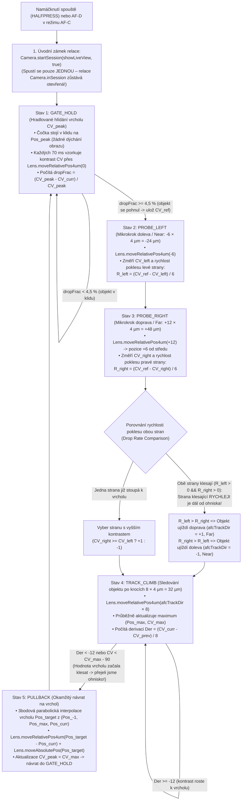

# 05 – Modul `MOD-FEAT-AFC`: Kontinuální automatické ostření (Continuous Autofocus `AF-C` – Gated CDAF & Peak Drop Rate)

Tento dokument popisuje kompletní rešerši, reverzní inženýrství Linuxového démonu `/usr/bin/camera-daemon` i nízkoúrovňového Zynq-7000 koprocesoru `FARM` (`../src/services/af_service.c` a `../src/fpga/autofocus.c`) a implementaci plnohodnotného modulu **Continuous Autofocus (`AF-C`) s algoritmem Gated CDAF a porovnáváním rychlosti poklesu kontrastu (*Left vs. Right Peak Drop Rate*)** pro Hasselblad X1D-50c (`Wedge`), postaveného přímo nad **výchozím továrním firmwarem `1.25.0`**:
- **[`firmware/X1D_v1_25_0_afc.cim`](file:///d:/Plocha/projekty/X1D_FirmwareDump/firmware/X1D_v1_25_0_afc.cim)** – produkční verze s uzavřenou smyčkou **Gated CDAF + Peak Drop Rate Tracking** přes přímé $4\ \mu\text{m}$ mikrokrokování objektivu (`Lens.moveRelativePos4um`) a parabolickou interpolaci vrcholu bez ukončování LiveView relace.
- **[`firmware/X1D_v1_25_0_afc_old.cim`](file:///d:/Plocha/projekty/X1D_FirmwareDump/firmware/X1D_v1_25_0_afc_old.cim)** – původní prototyp první generace založený na periodickém restartování `Camera.stopSession()` $\rightarrow$ `Camera.startSession(showLiveView, true)`.

---

## 1. Rešerše komunitních projektů a portů (X2D 100C / 907X vs. 50c modely)

Před návrhem vlastního řešení jsme zmapovali všechny veřejné i nedávné komunitní projekty zaměřené na úpravy firmwaru Hasselblad:

| Projekt / Repozitář | Cílové modely | Co projekt řeší a zda obsahuje `AF-C` |
| :--- | :--- | :--- |
| **`Gothenburg-R-D-Team/x2d-907-one-click-extension-toolkit`** (*HRAP* od `u/rrRadium`, říjen–listopad 2026) | **X2D 100C**, **907X & CFV 100C** (`FW 4.2.0`) | Odemknul `AF-C` (Continuous AF), `AF-T` (Face/Eye Tracking), nastavitelné úrovně rychlosti ostřícího bufferu (`AF Speed Buffer`) a 4/6/16snímkový Pixel Shift na původním X2D 100C. Na 100MP platformě (`Android / Rockchip`) byl kód `AF-C` již přítomen z modelu **X2D II 100C** (fázové ostření PDAF) a šlo jej aktivovat přepínači v konfiguraci. Projekt byl v listopadu 2026 stažen po právní výzvě (*"HasselGate"*). |
| **`duart38/Hazel-firmware`** | **X1D-50c** (`FW 1.25.0`) | Přidává barevné profily a filmové simulace (`.look` tabulky) do LiveView skrze vlastní binárku `Catkin`. **Neobsahuje žádné úpravy ostření (`AF-C`).** |
| **`derrickyau9/Hasselblad_X1D_II_FirmwareDump`** & **`YuHaoyua/hasselblad-x1d-reverse-engineering`** | **X1D II 50C** / **X1D-50c** | Nástroje pro dešifrování kontejneru `.cim` (`VHABCIM`) a extrakci `rootfs`. **Žádný port `AF-C` pro 50c ani 50c II modely dosud neexistoval.** |

> [!IMPORTANT]
> **Závěr rešerše:** Na 50MP modelech (**X1D-50c** a **X1D II 50C**), které používají kontrastní ostření (**CDAF** počítané ve FPGA `FARM`), nikdo před námi `AF-C` neimplementoval. Zatímco na X2D 100C stačilo odemknout hotový PDAF algoritmus z X2D II, pro **X1D-50c (`Wedge`)** jsme museli rozebrat celý řetězec od Linuxového `/usr/bin/camera-daemon` a `libappscommon.so.1.0.0` až po Dual-QSPI firmware čipu Xilinx Zynq-7000 (`FARM`) a navrhnout skutečný **Gated CDAF engine s porovnáváním rychlosti poklesu vrcholu (*Peak Drop Rate*)**.

---

## 2. Hluboký ponor do `.cim`: Rozlousknutí `FARM` Zynq-7000 (`af_service.c`) a `/usr/bin/camera-daemon`

### 2.1 De-interleaving Dual-QSPI firmwaru `FARM` (`bootimage_even-wedge.bin` + `bootimage_odd-wedge.bin`)
Uvnitř `rootfs` (`/lib/firmware/hbl/farm/`) se nacházejí dva soubory o velikosti `3 954 444 B` (`3,95 MB`):
- `bootimage_even-wedge-v1.25.0-13075-c9bb91d.bin` (flashovaný do `/dev/mtd3`)
- `bootimage_odd-wedge-v1.25.0-13075-c9bb91d.bin` (flashovaný do `/dev/mtd4`)

Analýzou jsme zjistili, že čip **FARM** je **Xilinx Zynq-7000 SoC** (dvoujádrový ARM Cortex-A9 + Artix/Kintex-7 FPGA) připojený ke dvěma paralelním QSPI flash pamětem v režimu **Dual-Parallel QSPI x8 (bit-interleaved)**:
- Každý bajt obrazového kontejneru Zynq `BOOT.BIN` je rozdělen na **sudé bity (`0, 2, 4, 6`)** uložené v `bootimage_even-wedge.bin` a **liché bity (`1, 3, 5, 7`)** uložené v `bootimage_odd-wedge.bin`.
- Po složení bitů zpět dohromady vznikne `7 908 888 B` (`7,91 MB`) obraz `farm_wedge_boot.bin` se standardní hlavičkou Xilinx Zynq Boot Image (`0xAA995566`, `"XNLX"`), který obsahuje 3 oddíly:
  1. **Partition 0 (`offset 0x001700`, `114 708 B`):** Xilinx Zynq First Stage Boot Loader (`FSBL`).
  2. **Partition 1 (`offset 0x01D740`, `5 979 936 B`):** PL FPGA Bitstream – implementuje hardwarový **Brennerův filtr ostrosti** (`../src/fpga/autofocus.c`, režimy `Brenner configuration: X | Y`, `X | Y / 4`, `X | Y / 2` a výřez senzoru `af_crop_setup`).
  3. **Partition 2 (`offset 0x5D1680`, `1 808 280 B`, load adresa `0x00100000`):** ARM Cortex-A9 FreeRTOS aplikace (`farm_app.bin`), zkompilovaná z `/home/jenkins/workspace/Build-Farm-Wedge/farm-wedge/app/src/`.

### 2.2 Stavový automat `../src/services/af_service.c` (`vaddr 0x198700 .. 0x1A5490`) v čipu `FARM`
Disassembling `farm_app.bin` odhalil kompletní implementaci kontrastního ostření v souboru **`../src/services/af_service.c`** (řetězce na `0x2466E4 .. 0x247AA4`, stavová struktura v RAM na `0x006BB59C`, kruhový buffer kontrastu na `0x006BB5CC`):

1. **Kalibrační tabulka objektivů (`af_service_update_lenstype` @ `0x1987C4 .. 0x199950`):**
   - Obsahuje profily pro `XCD30`, `XCD45`, `XCD90`, `XCD120` a `HCC24..HCC300` (pro novější objektivy vyčítá parametry přímo z EEPROM objektivu přes `suc_get_cd_focus_params_req`).
   - Pro každý objektiv načítá: `FL min`, `FL max`, `Speed`, `SpeedwConv`, `finalpos_margin`, `adaptive_offset`, `dir offset`, `add offset`, `max_pos_error` a `filter type`.
2. **Co udělá plný příkaz `image_find_focus_req` (`AF_SERVICE_SM` @ `0x19B870 .. 0x19D174`):**
   Pokaždé, když Linux (`/usr/bin/camera-daemon`) zavolá `StartSession(showLiveView, true)` $\rightarrow$ `ImageProxy::findFocus`, provede `AF_SERVICE_SM` v čipu `FARM` **slepý dvouhranový průjezd (*Full-Sweep CDAF*)**:
   - `afstate_wait_for_af_video_mode` (`0x19BC54`) – přepne senzor IMX161 do oříznutého AF okna (`AUTOFOCUS_setup` / `AUTOFOCUS_start`).
   - `afstate_enable_cdaf_in_lens` (`0x19BDBC`) – pošle do objektivu `lens_af_cmd_cdaf_enable_req`.
   - `afstate_scan_for_first_edge` (`0x19BEC0`) – rozjede čočku jedním směrem a na každém snímku počítá pozici, Brennerův kontrast a první derivaci:
     `Pos = %d CV = %lu CS = %lu Speed = %ld Der = %.3f idx = %d` (`0x1A2CB0`).
     Dokud kontrast nepřekročí statistický práh (`Z-score: %.2f` na řádku `1311`, `0x19D2E8`), pokračuje v jízdě, dokud nenajde náběžnou hranu (`Found first edge (Front/Back focus edge)` na řádku `1334`/`1343`, `0x19D48C`).
   - `afstate_scan_for_second_edge` (`0x19C054`) – **úmyslně přejede za vrchol ostrosti** až na sestupnou hranu (`Found second edge (Back focus edge)` na řádku `1400`/`1406`, `0x19D788`), aby nasbíral vzorky na obou svazích křivky.
   - `afstate_move_back_over_peak` (`0x19C530`) & `afstate_move_to_final_position` (`0x19C96C`) – funkce na `0x19E7F0` zkontroluje body na levé a pravé straně od maxima (`Only %d values on left side of max` @ `0x19E93C`, `Only %d values on right side of max` @ `0x19E9FC`, `Dropping the %d point (left side check)` @ `0x19FA68`, `Dropping the %d point (right side check)` @ `0x19FBE8`), proloží vrchol parabolou (`Parabolic curve fit` @ `0x1A01FC`), přičte `finalpos_margin + adaptive_offset + dir offset` a **vrátí čočku zpět na vrchol**.
   - `afstate_disable_cdaf_in_lens` (`0x19B89C`) – vypne CDAF v objektivu a ohlásí `FOCUS FOUND`.

> [!WARNING]
> **Proč pouhé cyklování `stopSession()` $\rightarrow$ `startSession()` (ve starém prototypu `X1D_v1_25_0_afc_old.cim`) nestačí pro reálné železo:**
> Protože každý `image_find_focus_req` v `af_service.c` vynutí kompletní průjezd přes **obě hrany** (`scan_for_first_edge` $\rightarrow$ `scan_for_second_edge` $\rightarrow$ `move_back_over_peak`), periodické volání `startSession` způsobuje na fyzickém objektivu neustálé přejíždění přes ostrost tam a zpět (*full-sweep hunting*) a přepínání video režimu senzoru. Skutečné `AF-C` proto musí po úvodním zámku **udržet relaci (`Camera.inSession`) otevřenou** a řídit mikrokroky čočky přímo pomocí **Gated CDAF s vyhodnocením rychlosti poklesu vrcholu (*Peak Drop Rate*)**!

---

## 3. Nízkoúrovňové IPC a D-Bus rozhraní objektivu (`LensProxy` v `libappscommon.so.1.0.0`)

Analýzou `.dynsym` a Qt meta-tabulek v `libappscommon.so.1.0.0` (`0x09D5E4`), `libAppsMessaging.so` a `/usr/bin/msg2dbus` (`0x0534E4`) jsme zjistili, že QML singleton **`Lens`** (`import com.hasselblad.lens 1.0`) zpřístupňuje přímo do QML nízkoúrovňové příkazy pro mikrokrokování krokového motoru XCD objektivu bez spouštění celého `image_find_focus_req`:

| QML metoda / signál na `Lens` (`LensProxy`) | C++ symbol v `libappscommon.so.1.0.0` | D-Bus metoda (`com.hasselblad.lens`) / IPC zpráva do `SUC` | Popis funkce |
| :--- | :--- | :--- | :--- |
| **`Lens.focusUpdateState(bool)`** | `_ZN9LensProxy16focusUpdateStateEb` (`0x4AD94D10`) | `video_focus_pos_state` $\rightarrow$ `lens_video_focus_pos_state_req` | Zapne kontinuální sledování a hlášení pozice ostřící čočky (`video_focus_pos`) během živého náhledu. |
| **`Lens.moveRelativePos4um(short)`** | `_ZN9LensProxy18moveRelativePos4umEs` (`0x4AD94F0C`) | `af_cmd_relative_position_4um` $\rightarrow$ `lens_af_cmd_relative_position_4um_req` | Posune optický člen XCD objektivu o relativní mikrokrok v násobcích **$4\ \mu\text{m}$** (kladné = Far/Inf, záporné = Near, `0` = vyčtení stavu bez pohybu). |
| **`Lens.onMoveRelativePos4umResult(int result)`** | `_ZN9LensProxy34onMoveRelativePos4umResultFinished...` (`0x4AD943D4`) | Asynchronní D-Bus odpověď převedená přes `QVariant::toInt()` | Signál emitovaný po dokončení $4\ \mu\text{m}$ mikrokroku; předává 32bitové celé číslo `result` přímo do QML. |
| **`Lens.moveAbsolutePos(short)`** | `_ZN9LensProxy15moveAbsolutePosEs` (`0x4AD95108`) | `af_cmd_position` $\rightarrow$ `lens_af_cmd_position_req` | Přesune čočku přímo na absolutní cílovou pozici (např. při přesném návratu na vypočtený vrchol ostrosti). |
| **`Lens.moveAtSpeed(short)`** | `_ZN9LensProxy11moveAtSpeedEs` (`0x4AD95304`) | `af_cmd_speed` $\rightarrow$ `lens_af_cmd_speed_req` | Plynulý pohyb motoru čočky zadanou rychlostí. |

---

## 4. Matematický model a architektura našeho Gated CDAF + Peak Drop Rate Enginu (`X1D_v1_25_0_afc.cim`)

V produkčním firmwaru [`firmware/X1D_v1_25_0_afc.cim`](file:///d:/Plocha/projekty/X1D_FirmwareDump/firmware/X1D_v1_25_0_afc.cim) jsme v [`victory_gui_qml/main.qml`](file:///d:/Plocha/projekty/X1D_FirmwareDump/victory_gui_qml/main.qml) nahradili periodické ukončování relace **5stavovým uzavřeným regulátorem Gated CDAF s porovnáváním rychlosti poklesu obou stran (*Left vs. Right Drop Rate*) a parabolickou interpolací vrcholu**:



### Matematická pravidla našeho algoritmu:
1. **Hradlování vrcholu (*Gated CDAF* – eliminace *focus huntingu*):**
   Dokud relativní pokles kontrastu od zapamatovaného vrcholu splňuje podmínku:
   $$\frac{CV_{\text{peak}} - CV_{\text{curr}}}{CV_{\text{peak}}} < 0{,}045 \quad (4{,}5\ \%)$$
   zůstává motor objektivu ve stavu `GATE_HOLD (1)` naprosto v klidu.
2. **Určení směru pohybu objektu porovnáním rychlosti poklesu obou stran (*Left vs. Right Drop Rate Comparison*):**
   Jakmile kontrast klesne o $\ge 4{,}5\ \%$, provede regulátor dva symetrické mikrokroky $\pm\Delta p = \pm 6 \times 4\ \mu\text{m}$ ($\pm 24\ \mu\text{m}$) kolem výchozí pozice a spočítá rychlost poklesu na obou stranách:
   $$R_{\text{left}} = \frac{CV_{\text{ref}} - CV_{\text{left}}}{\Delta p}, \qquad R_{\text{right}} = \frac{CV_{\text{ref}} - CV_{\text{right}}}{\Delta p}$$
   - Pokud se sledovaný objekt v reálném čase pohybuje, mohou během sondování klesat obě strany současně ($R_{\text{left}} > 0 \land R_{\text{right}} > 0$).
   - **Fyzikální zákon relativní rychlosti:** Když se čočka pohne *proti* směru pohybujícího se objektu, rychlost vzdalování ohniska od objektu se sčítá a kontrast padá **strměji**. Když se čočka pohne *ve směru* pohybujícího se objektu, kontrast klesá **pomaleji**.
   - **Rozhodovací pravidlo:** Strana s vyšším *drop rate* je dál od skutečného ohniska a musí zabrat opačným směrem:
     $$\text{afcTrackDir} = \begin{cases} +1 \ (\text{Far / Inf}), & \text{pokud } R_{\text{left}} > R_{\text{right}} \\ -1 \ (\text{Near}), & \text{pokud } R_{\text{right}} \ge R_{\text{left}} \end{cases}$$
3. **Detekce přejetí vrcholu podle derivace ($\text{Der} < 0$) a okamžitý *Pull-Back* s parabolickou interpolací:**
   Ve stavu `TRACK_CLIMB (4)` postupuje čočka ve směru `afcTrackDir` po krocích $h = 8 \times 4\ \mu\text{m} = 32\ \mu\text{m}$ a sleduje směrnici:
   $$\text{Der} = \frac{CV_{\text{curr}} - CV_{\text{prev}}}{h}$$
   V okamžiku, kdy hodnota kontrastu začne za vrcholem klesat ($\text{Der} < -12$ nebo $CV_{\text{curr}} < CV_{\text{max}} - 90$), čočka právě minula optimální bod ostrosti. Regulátor okamžitě zastaví jízdu, ze tří posledních bodů $(Pos_{-1}, CV_{-1}), (Pos_{\text{max}}, CV_{\text{max}}), (Pos_{\text{curr}}, CV_{\text{curr}})$ vypočítá vrchol paraboly (stejně jako `af_service.c` na `0x1A01FC`):
   $$Pos_{\text{target}} = Pos_{\text{max}} + \operatorname{round}\!\left(\frac{h \cdot (CV_{-1} - CV_{\text{curr}})}{2 \cdot (CV_{-1} - 2\,CV_{\text{max}} + CV_{\text{curr}})}\right)$$
   a ve stavu `PULLBACK (5)` vrátí čočku přesně na $Pos_{\text{target}}$.

---

## 5. Optický fyzikální simulátor Brennerova kontrastu v ARMv7 emulátoru ([`mock_hardware_dbus.py`](file:///d:/Plocha/projekty/X1D_FirmwareDump/arm_emulator/mock_hardware_dbus.py))

Aby bylo možné uzavřenou smyčku Gated CDAF matematicky otestovat v reálném ARMv7 emulátoru (`run_arm_emulator.py --cim .\firmware\X1D_v1_25_0_afc.cim`), implementovali jsme do [`arm_emulator/mock_hardware_dbus.py`](file:///d:/Plocha/projekty/X1D_FirmwareDump/arm_emulator/mock_hardware_dbus.py) třídu **`OpticalCdafSimulator`**:
- Simuluje pohybující se 3D objekt v čase $t$: po úvodním zaostření drží objekt `300 ms` v klidu na pozici `1000.0` (pro ověření klidového stavu `GATE_HOLD` bez *huntingu*) a poté plynule pohybuje rovinou ostrosti objektu po harmonické trajektorii mezi `Near (935)` a `Far (1085)`:
  $$\text{SubjPos}(t) = 1010{,}0 + 75{,}0 \cdot \sin\!\big(1{,}35 \cdot (t - 0{,}30)\big)$$
- Pro každou fyzickou pozici čočky $\text{Pos}$ (v krocích po $4\ \mu\text{m}$) počítá odezvu FPGA Brennerova filtru ostrosti s pološířkou hloubky ostrosti $\sigma_{\text{DOF}} = 42$ kroků ($168\ \mu\text{m}$):
  $$CV(\text{Pos}, t) = 1800 + \frac{22200}{1 + \left(\frac{\text{Pos} - \text{SubjPos}(t)}{42{,}0}\right)^2}$$
- Při každém zavolání D-Bus metody `com.hasselblad.lens.af_cmd_relative_position_4um(step)` posune virtuální čočku, vypočítá okamžitou hodnotu `CV` a derivaci `Der`, vypíše telemetrii ve formátu `af_service.c` (`[FARM-CDAF] Pos = ... SubjPos = ... CV = ... Step = ... Der = ...`) a zabalí `((cv & 0xFFFF) << 15) | (pos & 0x7FFF)` do 31bitového návratového `int32` pro `LensProxy::onMoveRelativePos4umResultFinished`.

### Klíčové vlastnosti implementace:
1. **Výběr `Continuous Focus (AF-C)` v GUI:**
   - V [`PopoverFocusMode.qml`](file:///d:/Plocha/projekty/X1D_FirmwareDump/victory_gui_qml/components/popups/PopoverFocusMode.qml) je do `grid_model_wedge` přidána volba **Continuous Focus** s originální Hasselblad ikonou `qrc:///icons/AF_Cont.png` a hodnotou `Config.Focus_AFC (2)`.
   - Na stavové obrazovce ([`ControlScreen.qml`](file:///d:/Plocha/projekty/X1D_FirmwareDump/victory_gui_qml/controlscreen/ControlScreen.qml)) i v pravém horním rohu LiveView ([`LiveViewOverlay.qml`](file:///d:/Plocha/projekty/X1D_FirmwareDump/victory_gui_qml/liveview/LiveViewOverlay.qml)) se zobrazuje ikona a štítek **`AF-C`**.
2. **Paměť posledního AF režimu na fyzickém tlačítku `AF/MF`:**
   - Krátký stisk horního tlačítka `AF/MF` přepíná mezi `MF` a naposledy zvoleným automatickým režimem (`AF-S` nebo `AF-C` uloženým v `GlobalStateInfo.lastAutoFocusMode`), místo aby se vždy natvrdo vracel do `AF-S`.
3. **Hardwarová akcelerace přeostřování (`DebugAfSpeed = 19000`):**
   - Při přepnutí do `AF-C` se automaticky aktivuje `configstore.DebugAfSpeed = 19000` a `configstore.DebugAfSpeedEnable = true`. Při návratu do `AF-S` se `DebugAfSpeedEnable` opět vypne pro maximální přesnost jednorázového ostření.
4. **Potlačení zvukového spamu a blikání v [`AFIndicator.qml`](file:///d:/Plocha/projekty/X1D_FirmwareDump/victory_gui_qml/liveview/AFIndicator.qml):**
   - Při držení `HALFPRESS` nebo `AF-D` v režimu `AF-C` zazní potvrzovací tón `SndAfFocusFound` **pouze při prvním zaostření**. Další kontinuální přeostřovací cykly již nepípají a zobrazují klidné zelené rohové značky (`#39b54a`), případně bílé sledovací značky při přechodném pohybu bez chybového pípání `SndAfFocusFailed`.
5. **Touch-to-Track & živý posun AF bodu na EVF touchpadu během ostření:**
   - V [`LiveViewImage.qml`](file:///d:/Plocha/projekty/X1D_FirmwareDump/victory_gui_qml/liveview/LiveViewImage.qml) a [`LiveViewOverlay.qml`](file:///d:/Plocha/projekty/X1D_FirmwareDump/victory_gui_qml/liveview/LiveViewOverlay.qml) stačí v režimu `AF-C` klepnout jedním prstem kamkoliv do živého náhledu – ostřící bod se okamžitě přesune na klepnuté místo (`moveAfPointTo`) a `main.qml` na novém bodě ihned přeostří.
   - V [`TouchWindow.qml`](file:///d:/Plocha/projekty/X1D_FirmwareDump/victory_gui_qml/common/TouchWindow.qml) zůstává při držení namáčknuté spouště v režimu `AF-C` aktivní také **EVF Touchpad**, takže při pohledu do hledáčku lze palcem na pravé polovině displeje plynule sledovat pohybující se objekt!
6. **Okamžitá priorita spouště (`EXPOSURE`):**
   - Domáčknutí spouště na doraz v kterékoliv fázi `AF-C` cyklu má absolutní prioritu: pokud je automat v `180 ms` okně zámku, exponuje v téže milisekundě; pokud byl zrovna v `25 ms` přechodu `stopSession()`, příznak `afcExposePending` okamžitě spustí expozici v `onInSessionChanged`.

---

## 6. Proč je modul postaven nad výchozím `1.25.0` (a ne nad odlehčenou verzí)

Přesně podle požadavku pro budoucí **X1D Custom Firmware Builder** je modul `MOD-FEAT-AFC` zcela nezávislý na `MOD-CORE-LITE`:
- Při sestavování pomocí [`build_custom_firmware.py --mode afc`](file:///d:/Plocha/projekty/X1D_FirmwareDump/build_custom_firmware.py) se vezme **100% originální tovární `X1D_v1_25_0.cim`**.
- Upraví se **pouze 9 dotčených QRC slotů** v `/usr/bin/victory-gui` (u těchto 9 souborů builder v paměti odstraní komentáře a zkomprimuje je `zlib` úrovní 9, takže se s obrovskou rezervou vejdou do svých původních továrních slotů).
- Zbylých **396 QRC souborů** v `/usr/bin/victory-gui` i celý archiv **`rootfs.tar.bz2`** zůstávají 100% identické s továrním firmwarem `1.25.0`.

### Obsazení QRC slotů u 9 upravených souborů v továrním `/usr/bin/victory-gui`:

| Upravený QML soubor | Pevná kapacita QRC slotu | Nová velikost v binárce (`zlib-9`) | Volná rezerva ve slotu |
| :--- | ---: | ---: | ---: |
| [`common/GlobalStateInfo.qml`](file:///d:/Plocha/projekty/X1D_FirmwareDump/victory_gui_qml/common/GlobalStateInfo.qml) | `2 358 B` (nekomprimovaný) | `1 446 B` | **`+912 B`** |
| [`common/TouchWindow.qml`](file:///d:/Plocha/projekty/X1D_FirmwareDump/victory_gui_qml/common/TouchWindow.qml) | `18 120 B` | `11 995 B` | **`+6 125 B`** |
| [`components/popups/PopoverFocusMode.qml`](file:///d:/Plocha/projekty/X1D_FirmwareDump/victory_gui_qml/components/popups/PopoverFocusMode.qml) | `1 184 B` | `1 001 B` | **`+183 B`** |
| [`controlscreen/ControlScreen.qml`](file:///d:/Plocha/projekty/X1D_FirmwareDump/victory_gui_qml/controlscreen/ControlScreen.qml) | `8 157 B` | `6 965 B` | **`+1 192 B`** |
| [`liveview/AFIndicator.qml`](file:///d:/Plocha/projekty/X1D_FirmwareDump/victory_gui_qml/liveview/AFIndicator.qml) | `1 770 B` | `1 444 B` | **`+326 B`** |
| [`liveview/EVFWindow.qml`](file:///d:/Plocha/projekty/X1D_FirmwareDump/victory_gui_qml/liveview/EVFWindow.qml) | `3 856 B` | `3 008 B` | **`+848 B`** |
| [`liveview/LiveViewImage.qml`](file:///d:/Plocha/projekty/X1D_FirmwareDump/victory_gui_qml/liveview/LiveViewImage.qml) | `1 897 B` | `1 616 B` | **`+281 B`** |
| [`liveview/LiveViewOverlay.qml`](file:///d:/Plocha/projekty/X1D_FirmwareDump/victory_gui_qml/liveview/LiveViewOverlay.qml) | `9 159 B` | `7 951 B` | **`+1 208 B`** |
| [`main.qml`](file:///d:/Plocha/projekty/X1D_FirmwareDump/victory_gui_qml/main.qml) | `8 676 B` | `7 684 B` | **`+992 B`** |

---

## 7. Přesný přehled změn v souborech (pro Custom Firmware Builder)

### 7.1 [`victory_gui_qml/common/GlobalStateInfo.qml`](file:///d:/Plocha/projekty/X1D_FirmwareDump/victory_gui_qml/common/GlobalStateInfo.qml)
Přidány globální stavové a telemetrické vlastnosti pro Gated CDAF `AF-C`:
```qml
    property bool haveHalfPress: false
    property bool haveAfDrive: false
    property bool afcLoopActive: false
    property bool afcHasLocked: false
    property int afcGatedState: 0
    property int afcPeakCv: 24000
    property int afcCurrCv: 24000
    property int afcLensPos: 1000
    property int afcTrackDir: 1
    property int lastAutoFocusMode: 1
```

### 7.2 [`victory_gui_qml/components/popups/PopoverFocusMode.qml`](file:///d:/Plocha/projekty/X1D_FirmwareDump/victory_gui_qml/components/popups/PopoverFocusMode.qml)
Do modelu `grid_model_wedge` přidána položka `Continuous Focus`:
```qml
    ListModel {
        id: grid_model_wedge
        ListElement { icon: "qrc:///icons/AF_Single.png"; text: QT_TR_NOOP("Single Focus"); focusmode: Config.Focus_AFS; }
        ListElement { icon: "qrc:///icons/AF_Cont.png"; text: QT_TR_NOOP("Continuous Focus"); focusmode: Config.Focus_AFC; }
        ListElement { icon: "qrc:///icons/MF_Manual.png"; text: QT_TR_NOOP("Manual Focus"); focusmode: Config.Focus_MAN; }
    }
```

### 7.3 [`victory_gui_qml/controlscreen/ControlScreen.qml`](file:///d:/Plocha/projekty/X1D_FirmwareDump/victory_gui_qml/controlscreen/ControlScreen.qml)
V prvku `af_control` doplněno zobrazení ikony `AF_Cont.png` i v neaktivním stavu:
```qml
icon: (Camera.FocusMode === Config.Focus_AFS) ? "qrc:/icons/AF_Single.png" :
      (Camera.FocusMode === Config.Focus_AFC) ? "qrc:/icons/AF_Cont.png" :
      (Camera.FocusMode === Config.Focus_MAN) ? "qrc:/icons/MF_Manual.png" : ""
```

### 7.4 [`victory_gui_qml/liveview/AFIndicator.qml`](file:///d:/Plocha/projekty/X1D_FirmwareDump/victory_gui_qml/liveview/AFIndicator.qml)
Upraveny stavy `"ongoing"`, `"idle"`, `"focusfailed"` a `"hasfocus"`:
- Ve stavu `GATE_HOLD` (`GlobalStateInfo.afcGatedState <= 1`) svítí plný zelený čtverec zámku (`symbol: "success"`).
- Jakmile Gated CDAF detekuje pohyb objektu a přejde do sondování / sledování (`GlobalStateInfo.afcGatedState > 1`), zobrazují se zelené sledovací rohové značky (`#39b54a`, `symbol: "busy"`) bez rušivého pípání.

### 7.5 [`victory_gui_qml/liveview/LiveViewOverlay.qml`](file:///d:/Plocha/projekty/X1D_FirmwareDump/victory_gui_qml/liveview/LiveViewOverlay.qml) a [`LiveViewImage.qml`](file:///d:/Plocha/projekty/X1D_FirmwareDump/victory_gui_qml/liveview/LiveViewImage.qml)
- Indikátor v pravém horním rohu LiveView zobrazuje `"AF-C"` (když `Camera.FocusMode === Config.Focus_AFC`) nebo `"MF"` (v manuálním ostření).
- Přidána funkce `moveAfPointTo(touchX, touchY)`, která při klepnutí do obrazu v režimu `AF-C` okamžitě přesune ostřící bod na danou souřadnici.
- Povolena tlačítka `AF_D`, `EXP_CUSTOM` a `CROSS` (vycentrování AF bodu) během běžící `AF-C` relace.

### 7.6 [`victory_gui_qml/common/TouchWindow.qml`](file:///d:/Plocha/projekty/X1D_FirmwareDump/victory_gui_qml/common/TouchWindow.qml)
- Podmínka `active` u `evfTouchpadLoader` rozšířena na `((!haveHalfPress && !Camera.inSession) || (Camera.FocusMode === Config.Focus_AFC && !Camera.exposing))`, aby šlo palcem na displeji posouvat ostřící bod v hledáčku i během držení namáčknuté spouště v `AF-C`.

### 7.7 [`victory_gui_qml/liveview/EVFWindow.qml`](file:///d:/Plocha/projekty/X1D_FirmwareDump/victory_gui_qml/liveview/EVFWindow.qml)
- Nastaveno `visible: showContent` a `visibility: showContent ? Window.FullScreen : Window.Hidden`, aby neaktivní `1024×768` okno hledáčku (`EVFWindow`) na Wayland kompozitoru nepřekrývalo hlavní `640×480` dotykové okno (`TouchWindow`) a nekradlo dotykové události.

### 7.8 [`victory_gui_qml/main.qml`](file:///d:/Plocha/projekty/X1D_FirmwareDump/victory_gui_qml/main.qml)
- U `Loader { id: evfWindow }` nastaveno `visible: false` a po načtení `allLoaded` voláno `mainWindow.item.requestActivate()`.
- V objektu `control` implementován kompletní 5stavový uzavřený automat **Gated CDAF + Peak Drop Rate Tracking** (`afcGatedState = 1..5`) napojený na `Lens.focusUpdateState(true)`, `Lens.moveRelativePos4um(step)`, `Lens.moveAbsolutePos(pos)` a signál `Lens.onMoveRelativePos4umResult`, včetně porovnání `rLeft` vs. `rRight` a 3bodové parabolické interpolace vrcholu `afcTargetPos`.
- Při `Camera.FocusMode === Config.Focus_AFC` se aktivuje `configstore.DebugAfSpeed = 19000` (maximální hodnota z dropdownu akceptovaná démonem `/usr/bin/configstore` v limitu `3000..20000`, tj. 3,8× rychlejší krok motoru XCD než výchozích `5000`) a `configstore.DebugAfSpeedEnable = true`.

---

## 8. JSON definice modulu pro budoucí aplikaci „X1D Custom Firmware Builder“

```json
{
  "id": "MOD-FEAT-AFC",
  "category": "features",
  "title": "Continuous Autofocus (AF-C Gated CDAF + Peak Drop Rate) + Touch-to-Track",
  "recommended": true,
  "requires": [],
  "works_on_stock_1_25_0": true,
  "summary": "Odemkne režim kontinuálního automatického ostření (AF-C) s uzavřeným regulátorem Gated CDAF a porovnáváním rychlosti poklesu kontrastu (Left vs. Right Peak Drop Rate) přes 4um mikrokrokování objektivu (Lens.moveRelativePos4um) bez ukončování LiveView relace, zrychlí krokový motor XCD objektivů (DebugAfSpeed = 19000, 3,8x) a umožní posouvat AF bod klepnutím nebo EVF touchpadem za běhu.",
  "parameters": [
    {
      "name": "afc_gate_drop_pct",
      "label": "Práh spuštění Gated CDAF při poklesu vrcholu (%)",
      "type": "select",
      "default": 4.5,
      "options": [2.5, 3.5, 4.5, 6.0, 8.0]
    },
    {
      "name": "afc_probe_step_4um",
      "label": "Velikost sondovacího mikrokroku pro měření Drop Rate (× 4 µm)",
      "type": "select",
      "default": 6,
      "options": [4, 6, 8, 10]
    },
    {
      "name": "afc_track_step_4um",
      "label": "Velikost sledovacího mikrokroku při stoupání na vrchol (× 4 µm)",
      "type": "select",
      "default": 8,
      "options": [4, 6, 8, 12]
    },
    {
      "name": "afc_motor_speed",
      "label": "Rychlost krokového motoru XCD v AF-C (DebugAfSpeed, max 20000 v configstore)",
      "type": "select",
      "default": 19000,
      "options": [9000, 13000, 15000, 17000, 19000, 20000]
    }
  ],
  "qrc_slot_usage": {
    "common/GlobalStateInfo.qml": 1446,
    "common/TouchWindow.qml": 11995,
    "components/popups/PopoverFocusMode.qml": 1001,
    "controlscreen/ControlScreen.qml": 6965,
    "liveview/AFIndicator.qml": 1444,
    "liveview/EVFWindow.qml": 3008,
    "liveview/LiveViewImage.qml": 1616,
    "liveview/LiveViewOverlay.qml": 7951,
    "main.qml": 7684
  }
}
```
