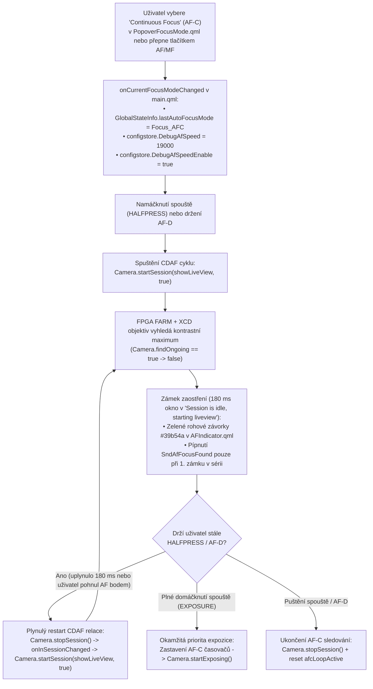

# 05 – Modul `MOD-FEAT-AFC`: Kontinuální automatické ostření (Continuous Autofocus `AF-C`)

Tento dokument popisuje kompletní rešerši, reverzní inženýrství binárky `/usr/bin/camera-daemon` a implementaci plnohodnotného modulu **Continuous Autofocus (`AF-C`)** pro Hasselblad X1D-50c (`Wedge`), postaveného přímo nad **výchozím továrním firmwarem `1.25.0`** ([`firmware/X1D_v1_25_0_afc.cim`](file:///d:/Plocha/projekty/X1D_FirmwareDump/firmware/X1D_v1_25_0_afc.cim)).

---

## 1. Rešerše komunitních projektů a portů (X2D 100C / 907X vs. 50c modely)

Před návrhem vlastního řešení jsme zmapovali všechny veřejné i nedávné komunitní projekty zaměřené na úpravy firmwaru Hasselblad:

| Projekt / Repozitář | Cílové modely | Co projekt řeší a zda obsahuje `AF-C` |
| :--- | :--- | :--- |
| **`Gothenburg-R-D-Team/x2d-907-one-click-extension-toolkit`** (*HRAP* od `u/rrRadium`, říjen–listopad 2026) | **X2D 100C**, **907X & CFV 100C** (`FW 4.2.0`) | Odemknul `AF-C` (Continuous AF), `AF-T` (Face/Eye Tracking), nastavitelné úrovně rychlosti ostřícího bufferu (`AF Speed Buffer`) a 4/6/16snímkový Pixel Shift na původním X2D 100C. Na 100MP platformě (`Android / Rockchip`) byl kód `AF-C` již přítomen z modelu **X2D II 100C** (fázové ostření PDAF) a šlo jej aktivovat přepínači v konfiguraci. Projekt byl v listopadu 2026 stažen po právní výzvě (*"HasselGate"*). |
| **`duart38/Hazel-firmware`** | **X1D-50c** (`FW 1.25.0`) | Přidává barevné profily a filmové simulace (`.look` tabulky) do LiveView skrze vlastní binárku `Catkin`. **Neobsahuje žádné úpravy ostření (`AF-C`).** |
| **`derrickyau9/Hasselblad_X1D_II_FirmwareDump`** & **`YuHaoyua/hasselblad-x1d-reverse-engineering`** | **X1D II 50C** / **X1D-50c** | Nástroje pro dešifrování kontejneru `.cim` (`VHABCIM`) a extrakci `rootfs`. **Žádný port `AF-C` pro 50c ani 50c II modely dosud neexistoval.** |

> [!IMPORTANT]
> **Závěr rešerše:** Na 50MP modelech (**X1D-50c** a **X1D II 50C**), které používají kontrastní ostření (**CDAF** počítané ve FPGA `FARM`), nikdo před námi `AF-C` neimplementoval. Zatímco na X2D 100C stačilo odemknout hotový PDAF algoritmus z X2D II, pro **X1D-50c (`Wedge`)** jsme museli zanalyzovat stavový automat `WedgeStateMachine` v `/usr/bin/camera-daemon` a navrhnout vlastní kontinuální CDAF engine přímo pro architekturu X1D.

---

## 2. Reverzní inženýrství `/usr/bin/camera-daemon` (Proč tovární X1D nemá `AF-C`)

Detailní disassembling binárky [`X1D_v1_25_0_extracted/bins/camera-daemon`](file:///d:/Plocha/projekty/X1D_FirmwareDump/X1D_v1_25_0_extracted/bins/camera-daemon) odhalil přesné chování C++ backendu:

1. **D-Bus & `configstore` přijímají `Config.Focus_AFC` (`2`) nativně:**
   - Metoda `Camera::setFocusMode(uchar)` (`vaddr 0x0217ec`) a `Camera::updateFocusMode()` (`vaddr 0x021524`) zapisují a čtou `FocusMode = 2` (`Config.Focus_AFC`) bez jakéhokoliv omezení.
   - Při hodnotě `2` nastaví interní příznak `Camera+0x120 = 2`.

2. **Co dělá `WedgeStateMachine::checkFocusMode()` (`vaddr 0x032864`):**
   ```c
   // Disassembly @ 0x032864 (file offset 0x022864):
   int mode = this->camera->FocusMode(); // r3
   if (mode == 3) {                      // 3 == Config.Focus_MAN (Manual Focus)
       emit this->expose();              // Přeskočí AF, rovnou připraveno k expozici
   } else if (this->forceFindFocus || this->camera->shouldFindFocus()) {
       emit this->findFocus();           // Pro AF-S (1) i AF-C (2) spustí CDAF ostření!
   } else {
       emit this->expose();
   }
   ```
   Tovární `WedgeStateMachine` tedy v režimu `Config.Focus_AFC (2)` **nativně spustí CDAF ostření** (`WedgeStateMachine::runAfAlgo()` -> `ImageProxy::findFocus(focus_point, focus_size)` na FPGA `FARM`)!

3. **Proč se tovární `WedgeStateMachine` po jednom zaostření zastaví (`vaddr 0x036c50..0x037150`):**
   - Jakmile `ImageProxy::findFocus` dokončí jeden průchod kontrastního ostření a nastaví čočku XCD na vrchol kontrastní křivky, přejde automat přes stav `"Auto focus finished"` (`0x026d24`) do stavu `"Session is idle, starting liveview"` (`0x026f7c`).
   - V tomto stavu automat drží živý náhled (`LiveView`) a čeká na:
     - `Camera.startExposing()` (`2exposuresRequested()`) -> okamžité sklopení závěrky a pořízení snímku, nebo
     - `Camera.stopSession()` (`2notInSession()`) -> přechod přes `"Finished state, sets liveview state"` zpět do `"Initial state"` (přičemž LiveView na displeji/EVF běží plynule dál!).

4. **Skrytý akcelerátor krokového motoru XCD objektivů v `camera-daemon` (`vaddr 0x020678`) a `configstore` (`0x13d68..0x13de0`):**
   - V konstruktoru `Camera::Camera` (`0x020678`) a v `/usr/bin/configstore` jsme objevili dvojici parametrů:
     - `configstore.DebugAfSpeedEnable` (`bool`)
     - `configstore.DebugAfSpeed` (`int`, výchozí hodnota `5000`, povolený rozsah v `configstore`: `min=3000 .. max=20000`)
   - Když je `DebugAfSpeedEnable = true` a `DebugAfSpeed = 19000` (nejvyšší platná položka z dropdownu `SettingsMiddleLayer`, akceptovaná `configstore` bez varování), `camera-daemon` řídí krokový motor XCD objektivu **3,8× vyšší rychlostí** než výchozích `5 000`, což výrazně zkracuje dobu jednoho CDAF přeostření (podobně jako *AF Speed Buffer* u X2D toolkitu)!

---

## 3. Architektura našeho `AF-C` Enginu pro X1D-50c

Náš modul `MOD-FEAT-AFC` kombinuje C++ schopnosti `WedgeStateMachine` s inteligentním řídicím automatem v [`main.qml`](file:///d:/Plocha/projekty/X1D_FirmwareDump/victory_gui_qml/main.qml):



### Klíčové vlastnosti implementace:
1. **Výběr `Continuous Focus (AF-C)` v GUI:**
   - V [`PopoverFocusMode.qml`](file:///d:/Plocha/projekty/X1D_FirmwareDump/victory_gui_qml/components/popups/PopoverFocusMode.qml) je do `grid_model_wedge` přidána volba **Continuous Focus** s originální Hasselblad ikonou `qrc:///icons/AF_Cont.png` a hodnotou `Config.Focus_AFC (2)`.
   - Na stavové obrazovce ([`ControlScreen.qml`](file:///d:/Plocha/projekty/X1D_FirmwareDump/victory_gui_qml/controlscreen/ControlScreen.qml)) i v pravém horním rohu LiveView ([`LiveViewOverlay.qml`](file:///d:/Plocha/projekty/X1D_FirmwareDump/victory_gui_qml/liveview/LiveViewOverlay.qml)) se zobrazuje ikona a štítek **`AF-C`**.
2. **Paměť posledního AF režimu na fyzickém tlačítku `AF/MF`:**
   - Krátký stisk horního tlačítka `AF/MF` přepíná mezi `MF` a naposledy zvoleným automatickým režimem (`AF-S` nebo `AF-C` uloženým v `GlobalStateInfo.lastAutoFocusMode`), místo aby se vždy natvrdo vracel do `AF-S`.
3. **Hardwarová akcelerace přeostřování (`DebugAfSpeed = 19000`):**
   - Při přepnutí do `AF-C` se automaticky aktivuje `configstore.DebugAfSpeed = 19000` a `configstore.DebugAfSpeedEnable = true`. Při návratu do `AF-S` se `DebugAfSpeedEnable` opět vypne pro maximální přesnost jednorázového ostření.
4. **Potlačení zvukového spamu a blikání v [`AFIndicator.qml`](file:///d:/Plocha/projekty/X1D_FirmwareDump/victory_gui_qml/liveview/AFIndicator.qml):**
   - Při držení `HALFPRESS` nebo `AF-D` v režimu `AF-C` zazní potvrzovací tón `SndAfFocusFound` **pouze při prvním zaostření**. Další kontinuální přeostřovací cykly již nepípají a zobrazují klidné zelené rohové značky (`#39b54a`), případně bílé sledovací značky při přechodném pohybu bez chybového pípání `SndAfFocusFailed`.
5. **Touch-to-Track & živý posun AF bodu na EVF touchpadu během ostření:**
   - V [`LiveViewImage.qml`](file:///d:/Plocha/projekty/X1D_FirmwareDump/victory_gui_qml/liveview/LiveViewImage.qml) a [`LiveViewOverlay.qml`](file:///d:/Plocha/projekty/X1D_FirmwareDump/victory_gui_qml/liveview/LiveViewOverlay.qml) stačí v režimu `AF-C` klepnout jedním prstem kamkoliv do živého náhledu – ostřící bod se okamžitě přesune na klepnuté místo (`moveAfPointTo`) a `main.qml` na novém bodě ihned přeostří.
   - V [`TouchWindow.qml`](file:///d:/Plocha/projekty/X1D_FirmwareDump/victory_gui_qml/common/TouchWindow.qml) zůstává při držení namáčknuté spouště v režimu `AF-C` aktivní také **EVF Touchpad**, takže při pohledu do hledáčku lze palcem na pravé polovině displeje plynule sledovat pohybující se objekt!
6. **Okamžitá priorita spouště (`EXPOSURE`):**
   - Domáčknutí spouště na doraz v kterékoliv fázi `AF-C` cyklu má absolutní prioritu: pokud je automat v `180 ms` okně zámku, exponuje v téže milisekundě; pokud byl zrovna v `25 ms` přechodu `stopSession()`, příznak `afcExposePending` okamžitě spustí expozici v `onInSessionChanged`.

---

## 4. Proč je modul postaven nad výchozím `1.25.0` (a ne nad odlehčenou verzí)

Přesně podle požadavku pro budoucí **X1D Custom Firmware Builder** je modul `MOD-FEAT-AFC` zcela nezávislý na `MOD-CORE-LITE`:
- Při sestavování pomocí [`build_custom_firmware.py --mode afc`](file:///d:/Plocha/projekty/X1D_FirmwareDump/build_custom_firmware.py) se vezme **100% originální tovární `X1D_v1_25_0.cim`**.
- Upraví se **pouze 9 dotčených QRC slotů** v `/usr/bin/victory-gui` (u těchto 9 souborů builder v paměti odstraní komentáře a zkomprimuje je `zlib` úrovní 9, takže se s obrovskou rezervou vejdou do svých původních továrních slotů).
- Zbylých **396 QRC souborů** v `/usr/bin/victory-gui` i celý archiv **`rootfs.tar.bz2`** zůstávají 100% identické s továrním firmwarem `1.25.0`.

### Obsazení QRC slotů u 9 upravených souborů v továrním `/usr/bin/victory-gui`:

| Upravený QML soubor | Pevná kapacita QRC slotu | Nová velikost v binárce (`zlib-9`) | Volná rezerva ve slotu |
| :--- | ---: | ---: | ---: |
| [`common/GlobalStateInfo.qml`](file:///d:/Plocha/projekty/X1D_FirmwareDump/victory_gui_qml/common/GlobalStateInfo.qml) | `2 358 B` (nekomprimovaný) | `1 278 B` | **`+1 080 B`** |
| [`common/TouchWindow.qml`](file:///d:/Plocha/projekty/X1D_FirmwareDump/victory_gui_qml/common/TouchWindow.qml) | `18 120 B` | `11 995 B` | **`+6 125 B`** |
| [`components/popups/PopoverFocusMode.qml`](file:///d:/Plocha/projekty/X1D_FirmwareDump/victory_gui_qml/components/popups/PopoverFocusMode.qml) | `1 184 B` | `1 001 B` | **`+183 B`** |
| [`controlscreen/ControlScreen.qml`](file:///d:/Plocha/projekty/X1D_FirmwareDump/victory_gui_qml/controlscreen/ControlScreen.qml) | `8 157 B` | `6 965 B` | **`+1 192 B`** |
| [`liveview/AFIndicator.qml`](file:///d:/Plocha/projekty/X1D_FirmwareDump/victory_gui_qml/liveview/AFIndicator.qml) | `1 770 B` | `1 419 B` | **`+351 B`** |
| [`liveview/EVFWindow.qml`](file:///d:/Plocha/projekty/X1D_FirmwareDump/victory_gui_qml/liveview/EVFWindow.qml) | `3 856 B` | `3 008 B` | **`+848 B`** |
| [`liveview/LiveViewImage.qml`](file:///d:/Plocha/projekty/X1D_FirmwareDump/victory_gui_qml/liveview/LiveViewImage.qml) | `1 897 B` | `1 616 B` | **`+281 B`** |
| [`liveview/LiveViewOverlay.qml`](file:///d:/Plocha/projekty/X1D_FirmwareDump/victory_gui_qml/liveview/LiveViewOverlay.qml) | `9 159 B` | `7 951 B` | **`+1 208 B`** |
| [`main.qml`](file:///d:/Plocha/projekty/X1D_FirmwareDump/victory_gui_qml/main.qml) | `8 676 B` | `6 669 B` | **`+2 007 B`** |

---

## 5. Přesný přehled změn v souborech (pro Custom Firmware Builder)

### 5.1 [`victory_gui_qml/common/GlobalStateInfo.qml`](file:///d:/Plocha/projekty/X1D_FirmwareDump/victory_gui_qml/common/GlobalStateInfo.qml)
Přidány globální stavové vlastnosti pro `AF-C`:
```qml
    property bool haveHalfPress: false
    property bool haveAfDrive: false
    property bool afcLoopActive: false
    property bool afcHasLocked: false
    property int lastAutoFocusMode: 1 // Config.Focus_AFS (1) or Config.Focus_AFC (2)
```

### 5.2 [`victory_gui_qml/components/popups/PopoverFocusMode.qml`](file:///d:/Plocha/projekty/X1D_FirmwareDump/victory_gui_qml/components/popups/PopoverFocusMode.qml)
Do modelu `grid_model_wedge` přidána položka `Continuous Focus`:
```qml
    ListModel {
        id: grid_model_wedge
        ListElement { icon: "qrc:///icons/AF_Single.png"; text: QT_TR_NOOP("Single Focus"); focusmode: Config.Focus_AFS; }
        ListElement { icon: "qrc:///icons/AF_Cont.png"; text: QT_TR_NOOP("Continuous Focus"); focusmode: Config.Focus_AFC; }
        ListElement { icon: "qrc:///icons/MF_Manual.png"; text: QT_TR_NOOP("Manual Focus"); focusmode: Config.Focus_MAN; }
    }
```

### 5.3 [`victory_gui_qml/controlscreen/ControlScreen.qml`](file:///d:/Plocha/projekty/X1D_FirmwareDump/victory_gui_qml/controlscreen/ControlScreen.qml)
V prvku `af_control` doplněno zobrazení ikony `AF_Cont.png` i v neaktivním stavu:
```qml
icon: (Camera.FocusMode === Config.Focus_AFS) ? "qrc:/icons/AF_Single.png" :
      (Camera.FocusMode === Config.Focus_AFC) ? "qrc:/icons/AF_Cont.png" :
      (Camera.FocusMode === Config.Focus_MAN) ? "qrc:/icons/MF_Manual.png" : ""
```

### 5.4 [`victory_gui_qml/liveview/AFIndicator.qml`](file:///d:/Plocha/projekty/X1D_FirmwareDump/victory_gui_qml/liveview/AFIndicator.qml)
Upraveny stavy `"ongoing"`, `"idle"`, `"focusfailed"` a `"hasfocus"`:
- Během aktivní smyčky `GlobalStateInfo.afcLoopActive` po prvním zámku (`GlobalStateInfo.afcHasLocked = true`) zůstávají rohové značky ostřícího bodu zelené (`#39b54a`) i během rychlého doskenování, takže hledáček nebliká červeně/bíle.
- Zvuk `SoundControl.SndAfFocusFound` se přehraje pouze při prvním zaostření po namáčknutí spouště.

### 5.5 [`victory_gui_qml/liveview/LiveViewOverlay.qml`](file:///d:/Plocha/projekty/X1D_FirmwareDump/victory_gui_qml/liveview/LiveViewOverlay.qml) a [`LiveViewImage.qml`](file:///d:/Plocha/projekty/X1D_FirmwareDump/victory_gui_qml/liveview/LiveViewImage.qml)
- Indikátor v pravém horním rohu LiveView zobrazuje `"AF-C"` (když `Camera.FocusMode === Config.Focus_AFC`) nebo `"MF"` (v manuálním ostření).
- Přidána funkce `moveAfPointTo(touchX, touchY)`, která při klepnutí do obrazu v režimu `AF-C` okamžitě přesune ostřící bod na danou souřadnici.
- Povolena tlačítka `AF_D`, `EXP_CUSTOM` a `CROSS` (vycentrování AF bodu) během běžící `AF-C` relace.

### 5.6 [`victory_gui_qml/common/TouchWindow.qml`](file:///d:/Plocha/projekty/X1D_FirmwareDump/victory_gui_qml/common/TouchWindow.qml)
- Podmínka `active` u `evfTouchpadLoader` rozšířena na `((!haveHalfPress && !Camera.inSession) || (Camera.FocusMode === Config.Focus_AFC && !Camera.exposing))`, aby šlo palcem na displeji posouvat ostřící bod v hledáčku i během držení namáčknuté spouště v `AF-C`.

### 5.7 [`victory_gui_qml/liveview/EVFWindow.qml`](file:///d:/Plocha/projekty/X1D_FirmwareDump/victory_gui_qml/liveview/EVFWindow.qml)
- Nastaveno `visible: showContent` a `visibility: showContent ? Window.FullScreen : Window.Hidden`, aby neaktivní `1024×768` okno hledáčku (`EVFWindow`) na Wayland kompozitoru nepřekrývalo hlavní `640×480` dotykové okno (`TouchWindow`) a nekradlo dotykové události.

### 5.8 [`victory_gui_qml/main.qml`](file:///d:/Plocha/projekty/X1D_FirmwareDump/victory_gui_qml/main.qml)
- U `Loader { id: evfWindow }` nastaveno `visible: false` a po načtení `allLoaded` voláno `mainWindow.item.requestActivate()`.
- V objektu `control` přidána vlastnost `property int currentFocusMode: Camera.FocusMode` a handler `onCurrentFocusModeChanged:` (protože C++ signál `CameraProxy::FocusModeChanged` v `libappscommon.so.1.0.0` začíná velkým písmenem `F` a Qt 5.4 `Connections` by jej odmítl), dále časovače `afcHoldTimer` (`180 ms`), `afcNextScanTimer` (`25 ms`), `afcRestartTimer` (`45 ms`) a obsluha `onFindOngoingChanged`, `onFocus_pointChanged` a `onInSessionChanged`.
- Při `Camera.FocusMode === Config.Focus_AFC` se aktivuje `configstore.DebugAfSpeed = 19000` (maximální hodnota z dropdownu akceptovaná démonem `/usr/bin/configstore` v limitu `3000..20000`, tj. 3,8× rychlejší krok motoru XCD než výchozích `5000`) a `configstore.DebugAfSpeedEnable = true`.

---

## 6. JSON definice modulu pro budoucí aplikaci „X1D Custom Firmware Builder“

```json
{
  "id": "MOD-FEAT-AFC",
  "category": "features",
  "title": "Continuous Autofocus (AF-C) + Touch-to-Track",
  "recommended": true,
  "requires": [],
  "works_on_stock_1_25_0": true,
  "summary": "Odemkne režim kontinuálního automatického ostření (AF-C) ve výběru Focus Mode, zrychlí krokový motor XCD objektivů (DebugAfSpeed = 19000, 3,8x zrychlení), průběžně přeostřuje po dobu držení namáčknuté spouště nebo tlačítka AF-D a umožní posouvat AF bod klepnutím na displej nebo tažením po EVF touchpadu za běhu.",
  "parameters": [
    {
      "name": "afc_hold_ms",
      "label": "Interval přeostřování po zámku (ms)",
      "type": "select",
      "default": 180,
      "options": [100, 140, 180, 250, 350]
    },
    {
      "name": "afc_motor_speed",
      "label": "Rychlost krokového motoru XCD v AF-C (DebugAfSpeed, max 20000 v configstore)",
      "type": "select",
      "default": 19000,
      "options": [9000, 13000, 15000, 17000, 19000, 20000]
    }
  ],
  "qrc_slot_usage": {
    "common/GlobalStateInfo.qml": 1278,
    "common/TouchWindow.qml": 11995,
    "components/popups/PopoverFocusMode.qml": 1001,
    "controlscreen/ControlScreen.qml": 6965,
    "liveview/AFIndicator.qml": 1419,
    "liveview/EVFWindow.qml": 3008,
    "liveview/LiveViewImage.qml": 1616,
    "liveview/LiveViewOverlay.qml": 7951,
    "main.qml": 6669
  }
}
```
