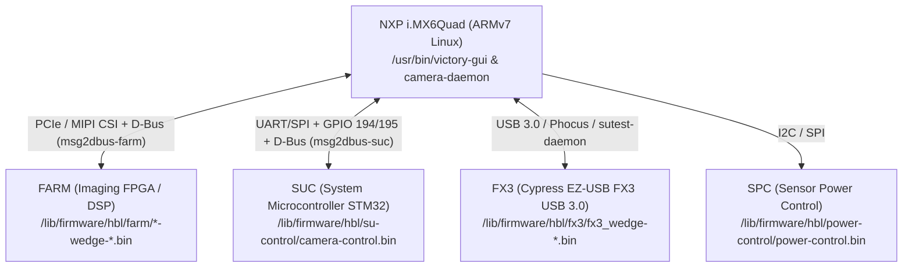

# 01 – Architecture & Hardware (Hasselblad X1D-50c)

## 1. Why X1D II and X2D Tools Do Not Work on the Original X1D-50c

Between the 1st-generation **X1D-50c (2016)** and the 2nd-generation **X1D II 50C (2019)** / **X2D 100C (2022)**, Hasselblad completely replaced both the hardware platform and the operating system:

| Property | **X1D-50c (1st Generation)** | **X1D II 50C / X2D 100C / 907X 100C** |
| :--- | :--- | :--- |
| **Platform Codename** | **Umbrella** (X1D body = **`Wedge`**) | Android / DJI-based platform |
| **Main SoC (Processor)** | **NXP / Freescale i.MX6Quad** (ARMv7-A hard-float, 4× Cortex-A9) | Multi-core ARM64 SoC with Android BSP |
| **Operating System** | **Yocto Linux** (`Hasselblad Umbrella Distro 2.0.3`, kernel `3.14.28`) | **Android** (`system.new.dat`, `vendor.new.dat`, SELinux OTA packages) |
| **Init System & IPC** | `systemd` + system **D-Bus** (`busctl`) | Android `init` + `binder` / `adb` |
| **Graphics Stack** | **Weston (Wayland)** with Vivante 2D acceleration (`--use-gal2d=1`) + **Qt 5.5.1 / QML** | Custom UI layer over Android / Linux |
| **`.cim` Payload Contents** | `hbl-upgrade`, `rootfs` (`tar.bz2`), `uboot`, `hbl-kks-revisions` | `ota.zip` (`META-INF`, `bootarea.img`, `normal.img`, `recovery.img`, `system`, `vendor`) |

> [!IMPORTANT]
> Although the outer `.cim` (`VHABCIM`) container uses the same AES-128-CBC encryption scheme across generations, the internal payload of the 1st-generation X1D-50c is a standard embedded Linux `rootfs` archive for the NXP i.MX6Quad SoC rather than an Android OTA image.

---

## 2. The Unified "Umbrella" Platform & Internal Model Codenames

Analysis of `/etc/os-release`, `/etc/build`, `hbl-kks-revisions`, and `/usr/bin/program_nodes.sh` reveals that `X1D_v1_25_0.cim` is a **single unified firmware image** shared across the entire family of Hasselblad cameras built on the **Umbrella** (i.MX6Quad) platform.

At boot time and during firmware upgrades, the system reads the hardware KKS revision burned into the processor's OTP fuse register (`/sys/fsl_otp/HW_OCOTP_GP1`) along with `SuModel` from `com.hasselblad.prodinfo` to identify the exact camera model:

| Internal Codename | OTP KKS (`HW_OCOTP_GP1`) | Device Tree (`.dtb`) | Retail Hasselblad Product |
| :--- | :--- | :--- | :--- |
| **`Wedge`** | `0x5f701d1b` – `0x5f701d26` (Rev 3, 6, 11, 12, 14) | `imx6q-hbl-wedge.dtb` | **Hasselblad X1D-50c** (named after the wedge-shaped grip) |
| **`Victory`** | `0x5f6e63b2` – `0x5f6e63bf` (Rev 2, 3, 7, 11–15) | `imx6q-hbl-victory.dtb` | **Hasselblad H6D-50c** (digital back) |
| **`Albatross`** | `0x5f70c8fe` – `0x5f70c901` (Rev 6–9) | `imx6q-hbl-victory.dtb` | **Hasselblad H6D-100c** (100MP digital back, supports 16-bit RAW) |
| **`A6D-50c` / `A6D-100c`** | `Victory` / `Albatross` + `SuModel == 63` | `imx6q-hbl-victory.dtb` | **Hasselblad A6D** (industrial / aerial surveying cameras) |
| **`H6D-MS`** | `Albatross` + `SuModel == 62` | `imx6q-hbl-victory.dtb` | **Hasselblad H6D Multi-Shot** |
| **`Idun`** | `0x5f714dc9` – `0x5f714dca` (Rev 1, 2) | `imx6q-hbl-idun.dtb` | **Hasselblad CFV II 50C / 907X** (1st-gen CFV digital back) |

### Build Metadata (`rootfs/etc/os-release` & `rootfs/etc/build`)
* **Distribution:** `Hasselblad Umbrella Distro` (`ID="hbl"`)
* **Firmware Version:** `v1.25.0` (`VERSION_ID="42"`, `BUILD_ID="2.0.3"`)
* **Build Timestamp:** `2020-10-22 08:08:43` (user `jenkins`, Yocto branch `jethro`)
* **Linux Kernel:** `3.14.28-1.0.0_ga+yocto+gf7d0ab5` (`/boot/zImage-3.14.28-1.0.0_ga+yocto+gf7d0ab5`)

---

## 3. Hardware Architecture & Internal Coprocessors (Nodes)

The main **NXP i.MX6Quad** processor (with 512 MB RAM on the X1D) handles the GUI, SD card storage, Wi-Fi, and system orchestration, while specialized real-time tasks are delegated to 4 subordinate coprocessors (*nodes*), whose firmware images reside in `rootfs/lib/firmware/hbl/`:

1. **FARM (`bootimage_even-wedge-v1.25.0-13075-c9bb91d.bin` & `bootimage_odd-wedge-...`)**
   * Main imaging FPGA / DSP responsible for reading the 50 MP Sony CMOS sensor, applying calibration maps (Gain, Offset, Blemish, ETC, GC), generating LiveView streams, and computing contrast-detection AF metrics (Brenner gradient).
   * Communicates with Linux via the `fpga_camera_mipi.ko` kernel module and the `msg2dbus-farm.service` D-Bus bridge (`com.hasselblad.farm`).
2. **SUC (`camera-control.bin` for `Wedge`, `su-control.bin` for `Victory`, `cfv-control.bin` for `Idun`)**
   * System Microcontroller (STM32 connected to `GPIO 194 = SUC_RST` and `GPIO 195 = SUC_BOOT0` in `hbl-upgrade`).
   * Manages camera body power states, physical buttons/wheels, lens communication (XCD/HC/HCD), leaf shutter control, and EVF proximity sensor.
   * Exposed to Linux via `msg2dbus-suc.service` (`com.hasselblad.suc` and `com.hasselblad.cambody`).
3. **FX3 (`fx3_wedge-v0.0-14268-e0ef6ae.bin`)**
   * **Cypress EZ-USB FX3** controller providing high-speed USB 3.0 connectivity for Phocus tethering and the `sutest-daemon` diagnostic channel.
4. **SPC (`power-control.bin`)**
   * Dedicated microcontroller managing the voltage rails of the medium-format CMOS sensor.

---

## 4. Internal eMMC Partition Layout (`/dev/mmcblk3`)

The camera uses a **dual-slot A/B update scheme**. During a firmware update from an SD card, the inactive slot is formatted and written first; only after all steps succeed does `hbl-post-upgrade` toggle the U-Boot environment variable `current_bootpart` between `1` (Slot A) and `3` (Slot B):

| Partition | Name | Filesystem | Purpose |
| :--- | :--- | :--- | :--- |
| `/dev/mmcblk3p1` | `boot_a` | `FAT32` (`vfat`) | Kernel `zImage` and Device Tree `.dtb` files for Slot A |
| `/dev/mmcblk3p2` | `root_a` | `ext4` (`ro`, journal disabled `^has_journal`) | Root filesystem (`rootfs`) for Slot A |
| `/dev/mmcblk3p3` | `boot_b` | `FAT32` (`vfat`) | Kernel `zImage` and Device Tree `.dtb` files for Slot B |
| `/dev/mmcblk3p4` | `root_b` | `ext4` (`ro`, journal disabled `^has_journal`) | Root filesystem (`rootfs`) for Slot B |
| `/media/data` | `data` | Writable partition | System logs (`/media/data/logs`), temporary firmware unpacking (`/media/data/upgrade`), calibration & persistent config data |

> [!TIP]
> Because the active `root_a` / `root_b` partition is mounted read-only (`ro`), all runtime modifications and temporary files live in `/tmp` or on the persistent `/media/data` partition.

---

## 5. Key `systemd` Services & Daemons

The primary services in `rootfs/lib/systemd/system/` and `/usr/bin/` include:

* **`weston.service` (`/usr/bin/weston.sh`)** – Launches the Weston Wayland compositor across `/dev/fbmain` (`fb0`, rear 640×480 LCD), `/dev/fbhdmi` (`fb2`), and `/dev/fbevf` (`fb4`, 1024×768 OLED viewfinder).
* **`victory-gui.service` (`/usr/bin/victory-gui -platform wayland`)** – Main camera user interface built with Qt 5.5.1 / QML.
* **`camera-daemon.service` (`/usr/bin/camera-daemon`)** – Central state-machine daemon exposing D-Bus services (`com.hasselblad.camera`, `com.hasselblad.config`, `com.hasselblad.bodysync`, etc.).
* **`msg2dbus-farm.service` & `msg2dbus-suc.service`** – Bridge daemons translating binary messages between the FPGA (`FARM`) / microcontroller (`SUC`) and the system D-Bus.
* **`upgrade-daemon.service` (`/usr/bin/upgrade-daemon`)** – Firmware update daemon responsible for decrypting `.cim` containers and executing `hbl-upgrade`.
* **`sutest-daemon.service` (`/usr/bin/sutest-daemon`) & `sutest-gui.service`** – Factory diagnostic and service daemon listening over USB (includes file transfer commands and `HblShell` root command execution).
