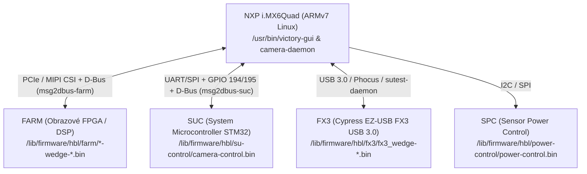

# 01 – Architektura a hardware (Hasselblad X1D-50c)

## 1. Proč nástroje z X1D II a X2D nefungují na první X1D-50c

Mezi první generací **X1D-50c (2016)** a druhou generací **X1D II 50C (2019)** / **X2D 100C (2022)** proběhla kompletní výměna hardwarové platformy i operačního systému:

| Vlastnost | **X1D-50c (1. generace)** | **X1D II 50C / X2D 100C / 907X 100C** |
| :--- | :--- | :--- |
| **Kódové označení platformy** | **Umbrella** (tělo X1D = **`Wedge`**) | Android / DJI-based platforma |
| **Hlavní SoC (procesor)** | **NXP / Freescale i.MX6Quad** (ARMv7-A hard-float, 4× Cortex-A9) | Vícejádrový ARM64 SoC s Android BSP |
| **Operační systém** | **Yocto Linux** (`Hasselblad Umbrella Distro 2.0.3`, kernel `3.14.28`) | **Android** (OTA balíčky `system.new.dat`, `vendor.new.dat`, SELinux) |
| **Init systém a IPC** | `systemd` + systémová sběrnice **D-Bus** (`busctl`) | Android `init` + `binder` / `adb` |
| **Grafický stack** | **Weston (Wayland)** s Vivante 2D akcelerací (`--use-gal2d=1`) + **Qt 5.5.1 / QML** | Vlastní UI nad Android / Linux vrstvou |
| **Obsah `.cim` souboru** | `hbl-upgrade`, `rootfs` (`tar.bz2`), `uboot`, `hbl-kks-revisions` | `ota.zip` (`META-INF`, `bootarea.img`, `normal.img`, `recovery.img`, `system`, `vendor`) |

> [!IMPORTANT]
> Přestože vnější obálka `.cim` (`VHABCIM`) používá u obou generací stejné šifrování AES-128-CBC, vnitřní obsah je u první X1D-50c klasický linuxový `rootfs` archiv pro procesor i.MX6Quad, nikoliv Android OTA obraz.

---

## 2. Unifikovaná platforma „Umbrella“ a kódová jména modelů

Ze souborů `/etc/os-release`, `/etc/build`, `hbl-kks-revisions` a `/usr/bin/program_nodes.sh` vyplývá, že firmware `X1D_v1_25_0.cim` je **společný unifikovaný obraz** pro celou rodinu fotoaparátů Hasselblad postavených na platformě **Umbrella** (i.MX6Quad).

Při startu a při aktualizaci si systém přečte hardwarové KKS číslo vypálené v OTP registru procesoru (`/sys/fsl_otp/HW_OCOTP_GP1`) a případně model ze služby `com.hasselblad.prodinfo` (`SuModel`), podle čehož rozpozná konkrétní zařízení:

| Interní kódové jméno | KKS v OTP (`HW_OCOTP_GP1`) | Device Tree (`.dtb`) | Skutečný produkt Hasselblad |
| :--- | :--- | :--- | :--- |
| **`Wedge`** | `0x5f701d1b` – `0x5f701d26` (Rev 3, 6, 11, 12, 14) | `imx6q-hbl-wedge.dtb` | **Hasselblad X1D-50c** (pojmenováno podle klínovitého tvaru gripu) |
| **`Victory`** | `0x5f6e63b2` – `0x5f6e63bf` (Rev 2, 3, 7, 11–15) | `imx6q-hbl-victory.dtb` | **Hasselblad H6D-50c** (digitální stěna) |
| **`Albatross`** | `0x5f70c8fe` – `0x5f70c901` (Rev 6–9) | `imx6q-hbl-victory.dtb` | **Hasselblad H6D-100c** (100MP stěna, podporuje 16bit RAW) |
| **`A6D-50c` / `A6D-100c`** | `Victory` / `Albatross` + `SuModel == 63` | `imx6q-hbl-victory.dtb` | **Hasselblad A6D** (průmyslové / letecké kamery) |
| **`H6D-MS`** | `Albatross` + `SuModel == 62` | `imx6q-hbl-victory.dtb` | **Hasselblad H6D Multi-Shot** |
| **`Idun`** | `0x5f714dc9` – `0x5f714dca` (Rev 1, 2) | `imx6q-hbl-idun.dtb` | **Hasselblad CFV II 50C / 907X** (1. generace stěny CFV) |

### Informace o sestavení (`rootfs/etc/os-release` a `rootfs/etc/build`)
* **Distribuce:** `Hasselblad Umbrella Distro` (`ID="hbl"`)
* **Verze firmwaru:** `v1.25.0` (`VERSION_ID="42"`, `BUILD_ID="2.0.3"`)
* **Čas sestavení:** `2020-10-22 08:08:43` (uživatel `jenkins`, Yocto větev `jethro`)
* **Linux kernel:** `3.14.28-1.0.0_ga+yocto+gf7d0ab5` (v `/boot/zImage-3.14.28-1.0.0_ga+yocto+gf7d0ab5`)

---

## 3. Hardwarová architektura a interní koprocesory (Nodes)

Hlavní procesor **NXP i.MX6Quad** (s 512 MB RAM u X1D) neřídí všechno sám – obsluhuje uživatelské rozhraní, ukládání na karty, Wi-Fi a orchestraci, zatímco specializované úlohy řeší 4 podřízené čipy (tzv. *nodes*), jejichž firmwary jsou uložené v `rootfs/lib/firmware/hbl/`:

1. **FARM (`bootimage_even-wedge-v1.25.0-13075-c9bb91d.bin` & `bootimage_odd-wedge-...`)**
   * Hlavní FPGA / obrazový procesor zpracovávající data ze senzoru (50 MP Sony CMOS), aplikující kalibrační mapy (Gain, Offset, Blemish, ETC, GC), živý náhled (LiveView) a výpočet ostrosti (Brenner gradient pro AF).
   * Komunikuje s Linuxem přes jaderný modul `fpga_camera_mipi.ko` a D-Bus bridge `msg2dbus-farm.service` (`com.hasselblad.farm`).
2. **SUC (`camera-control.bin` pro `Wedge`, `su-control.bin` pro `Victory`, `cfv-control.bin` pro `Idun`)**
   * Systémový mikrokontrolér (STM32, v `hbl-upgrade` připojený na `GPIO 194 = SUC_RST` a `GPIO 195 = SUC_BOOT0`).
   * Řídí napájení a zapínání těla, tlačítka, stavový displej, komunikaci s objektivem (XCD/HC/HCD), závěrku a EVF.
   * Do Linuxu je vystavený přes `msg2dbus-suc.service` (`com.hasselblad.suc` a `com.hasselblad.cambody`).
3. **FX3 (`fx3_wedge-v0.0-14268-e0ef6ae.bin`)**
   * Řadič **Cypress EZ-USB FX3** zajišťující rychlou USB 3.0 komunikaci s počítačem (tethering v aplikaci Phocus a servisní rozhraní `sutest-daemon`).
4. **SPC (`power-control.bin`)**
   * Mikrokontrolér pro přesné řízení napájecích větví středoformátového senzoru.

---

## 4. Rozložení oddílů na interní eMMC (`/dev/mmcblk3`)

Fotoaparát používá **A/B schéma aktualizací** (dual-slot), takže při běžné aktualizaci přes kartu se vždy formátuje a přepisuje neaktivní slot a teprve po úspěšném dokončení se v U-Boot prostředí přepne proměnná `current_bootpart` mezi hodnotami `1` (Slot A) a `3` (Slot B):

| Oddíl | Název | Souborový systém | Účel |
| :--- | :--- | :--- | :--- |
| `/dev/mmcblk3p1` | `boot_a` | `FAT32` (`vfat`) | Kernel `zImage` a Device Tree `.dtb` soubory pro Slot A |
| `/dev/mmcblk3p2` | `root_a` | `ext4` (`ro`, bez žurnálu `^has_journal`) | Kořenový souborový systém (`rootfs`) pro Slot A |
| `/dev/mmcblk3p3` | `boot_b` | `FAT32` (`vfat`) | Kernel `zImage` a Device Tree `.dtb` soubory pro Slot B |
| `/dev/mmcblk3p4` | `root_b` | `ext4` (`ro`, bez žurnálu `^has_journal`) | Kořenový souborový systém (`rootfs`) pro Slot B |
| `/media/data` | `data` | Zapisovatelný oddíl | Logy (`/media/data/logs`), dočasné rozbalení aktualizace (`/media/data/upgrade`), kalibrační a konfigurační data |

> [!TIP]
> Protože je aktivní `root_a` / `root_b` připojený pouze pro čtení (`ro`), veškeré běhové změny a dočasné soubory probíhají v `/tmp` nebo na perzistentním oddílu `/media/data`.

---

## 5. Klíčové systémové služby (`systemd`) a démoni

V `rootfs/lib/systemd/system/` a `/usr/bin/` běží tyto hlavní komponenty:

* **`weston.service` (`/usr/bin/weston.sh`)** – spouští Wayland kompozitor Weston na framebufferech `/dev/fbmain` (`fb0`, zadní LCD 640×480), `/dev/fbhdmi` (`fb2`) a `/dev/fbevf` (`fb4`, OLED hledáček 1024×768).
* **`victory-gui.service` (`/usr/bin/victory-gui -platform wayland`)** – hlavní grafické rozhraní fotoaparátu v Qt 5.5.1 / QML.
* **`camera-daemon.service` (`/usr/bin/camera-daemon`)** – ústřední řídicí démon fotoaparátu vystavující D-Bus služby (`com.hasselblad.camera`, `com.hasselblad.config`, `com.hasselblad.bodysync` atd.).
* **`msg2dbus-farm.service` & `msg2dbus-suc.service`** – překladatelské démony přemosťující komunikaci s FPGA (`FARM`) a mikrokontrolérem (`SUC`) na systémový D-Bus.
* **`upgrade-daemon.service` (`/usr/bin/upgrade-daemon`)** – démon starající se o dešifrování `.cim` souboru a spuštění aktualizace.
* **`sutest-daemon.service` (`/usr/bin/sutest-daemon`) & `sutest-gui.service`** – tovární diagnostický a servisní démon naslouchající na USB rozhraní (obsahuje mj. příkazy pro čtení souborů a root shell `HblShell`).
